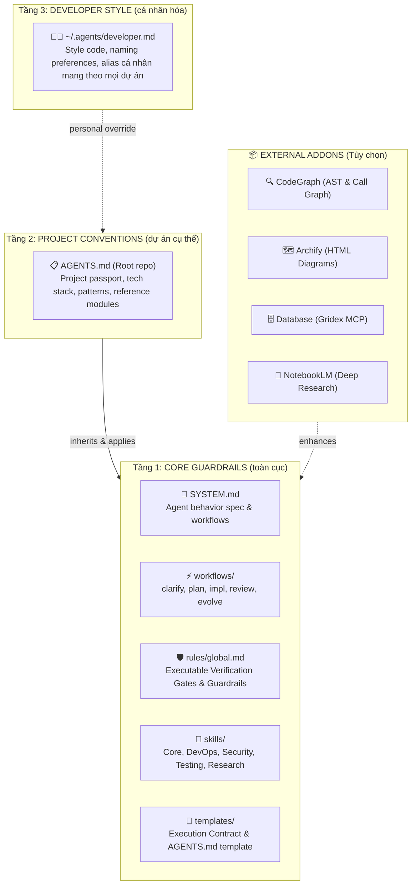
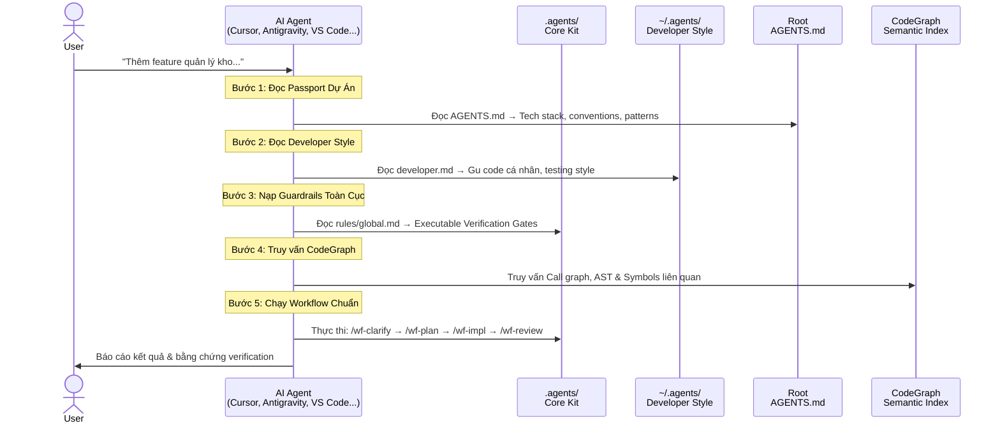
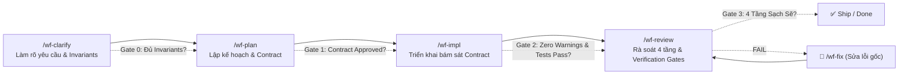
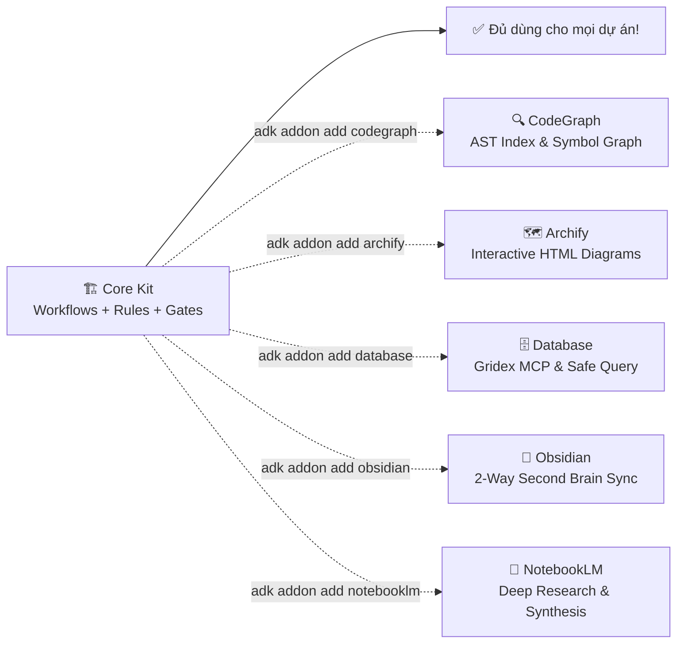

# 🤖 Agent-Dev-Kit — Cách hoạt động toàn bộ quy trình

## 1. Kiến trúc 3 tầng phân cấp



**Tóm tắt 3 tầng:**

- **Tầng 1 (Core Guardrails):** Cài qua `adk i` — chứa workflows chuẩn, rules bất biến, executable verification gates (zero-warning, unit tests 100%, linters 100%). Dùng **chung** cho mọi project.
- **Tầng 2 (Project Conventions):** File `AGENTS.md` tại root dự án — định nghĩa tech stack, architectural patterns và conventions **riêng** cho repo đó.
- **Tầng 3 (Developer Style):** File `~/.agents/developer.md` — gu code cá nhân (style, comment, testing preferences) tự động nạp xuyên suốt mọi dự án dev tham gia.

---

## 2. Luồng Agent khi nhận task



### Chi tiết từng bước:

| Bước | Agent làm gì | File / Công cụ | Mục đích |
|---|---|---|---|
| **1** | Đọc passport | `AGENTS.md` (root) | Biết tech stack, conventions, modules chuẩn của dự án |
| **2** | Đọc style dev | `~/.agents/developer.md` | Áp dụng thói quen code, format, alias cá nhân |
| **3** | Nạp guardrails | `.agents/rules/global.md` | Tuân thủ Executable Gates (Zero warnings, Tests 100%, Linters 100%) |
| **4** | Truy vấn code | `CodeGraph CLI / MCP` | Nắm vững call graph, AST symbols, giảm 35% token đọc mù |
| **5** | Tạo contract | Execution Contract | Giữ objective, scope, invariants và progress ledger |
| **6** | Chạy workflow | `/wf-*` | Thực thi quy trình kiểm soát chặt chẽ 4 giai đoạn |

---

## 3. Workflow Flow (Vòng đời chuẩn)

Quy trình chuẩn 4 giai đoạn: **Clarify → Plan → Impl → Review**



### Các workflow chính:

| Workflow | Khi nào dùng | Output chính |
|---|---|---|
| `/wf-clarify` | Bắt đầu task, yêu cầu còn mơ hồ | Invariants, Acceptance Criteria, Scope IN/OUT |
| `/wf-plan` | Lên kế hoạch kỹ thuật chi tiết | Execution Contract, File changes, Risk analysis |
| `/wf-impl` | Triển khai code bám sát plan | Code changes, Zero warnings, Unit tests passing |
| `/wf-review` | Rà soát 4 tầng trước khi merge | Verification Report (Executable Gates checked) |
| `/wf-fix` | Xử lý bug phát sinh | Root cause analysis & minimal surgical fix |
| `/wf-evolve` | Học hỏi và cải tiến bộ quy tắc | Tự động cập nhật rules/global.md từ feedback |

---

## 4. Kiểm soát chất lượng: Executable Verification Gates

Thay vì các checklist tĩnh dễ bị bỏ qua, Kit bắt buộc mọi thay đổi phải vượt qua **3 Cổng Thực Thi Tự Động**:

```
+-------------------------------------------------------------------------+
|                  EXECUTABLE VERIFICATION GATES                          |
+-------------------------------------------------------------------------+
|  1. Compilation / Build Gate:                                           |
|     - Zero compilation warnings (TreatWarningsAsErrors hoặc linter).     |
|  2. Test Suite Gate:                                                    |
|     - 100% unit tests pass, zero regressions trong regression suite.     |
|  3. Static Analysis / Linter Gate:                                      |
|     - 100% linter rules pass (ESLint, Biome, Roslyn, Ruff...).          |
+-------------------------------------------------------------------------+
```

Agent bắt buộc phải chạy lệnh test/build thực tế và trích xuất bằng chứng (Terminal output / exit code = 0) vào Verification Report trước khi tuyên bố hoàn thành.

---

## 5. Addons Mở Rộng (5 External Addons)

Agent-Dev-Kit giữ core siêu tinh gọn và hỗ trợ mở rộng qua 5 addon chuyên biệt:



| Addon | Lệnh cài | Mục đích |
|---|---|---|
| **codegraph** | `adk addon add codegraph` | Tự động phân tích AST, call graph & symbols, giảm 35% token đọc file |
| **archify** | `adk addon add archify` | Xuất sơ đồ kiến trúc HTML tương tác trực quan |
| **database** | `adk addon add database` | Tra cứu schema và query an toàn qua Gridex MCP (read-only) |
| **obsidian** | `adk addon add obsidian` | Đồng bộ tri thức hai chiều với Second Brain cá nhân |
| **notebooklm** | `adk addon add notebooklm` | Tích hợp nghiên cứu tài liệu sâu qua Google NotebookLM |

---

## 6. Khởi tạo Dự Án Mới (Dưới 30 giây)

```bash
# Bước 1: Mở terminal tại thư mục gốc dự án và chạy
adk i

# Bước 2: Thiết lập gu cá nhân (chỉ cần làm 1 lần trên máy)
adk profile

# Bước 3: Điền thông tin tech stack & conventions vào AGENTS.md

# Bước 4: Lập chỉ mục code bằng CodeGraph
adk addon add codegraph

# Bước 5: Bắt đầu làm việc trong chat!
/wf-clarify "Thêm tính năng đăng nhập SSO Google..."
```

---

## 7. Bảng Lệnh CLI `adk`

| Lệnh | Alias | Chức năng |
|---|---|---|
| `adk` | `adk help`, `adk -h` | Hiển thị bảng hướng dẫn sử dụng (mặc định) |
| `adk full` | `adk setup` | Khởi tạo trọn gói Full Setup (.agents/ + AGENTS.md + CodeGraph) |
| `adk i` | `adk install` | Tải và khởi tạo kit vào dự án hiện tại (`.agents/`) |
| `adk u` | `adk update` | Cập nhật core kit lên bản mới nhất |
| `adk profile` | — | Khởi tạo / chỉnh sửa gu code cá nhân (`~/.agents/developer.md`) |
| `adk addon` | `adk addons` | Menu quản lý, xem hướng dẫn và cài đặt 5 addons |
| `adk version` | `adk v`, `adk -v` | Xem phiên bản kit hiện tại |
