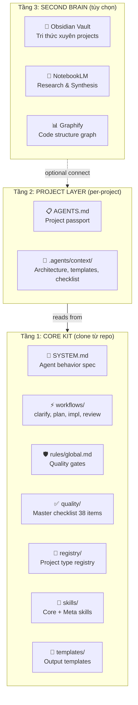
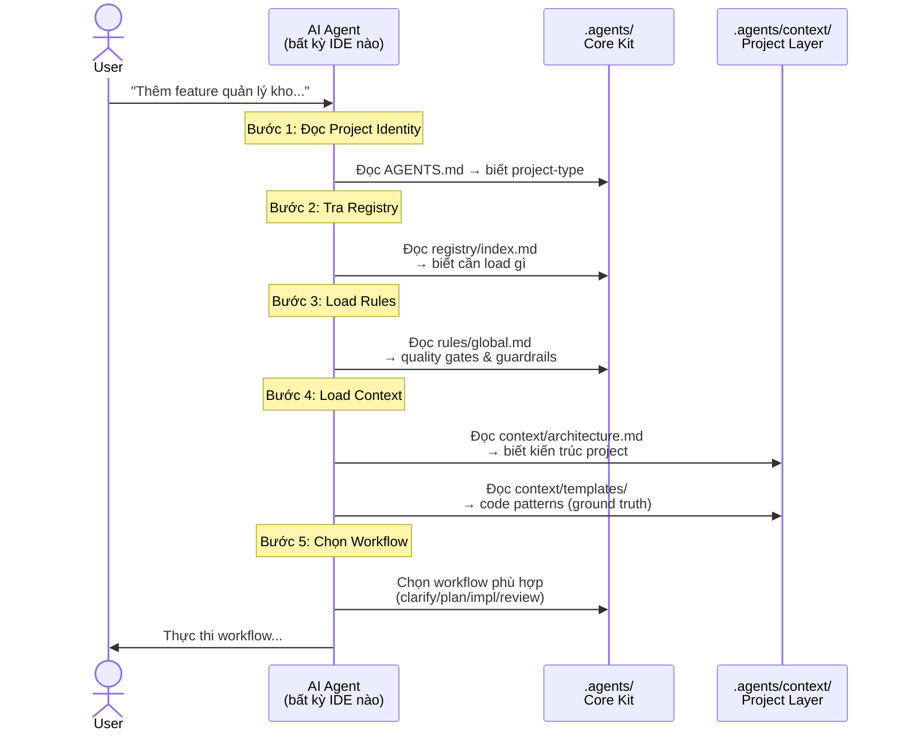
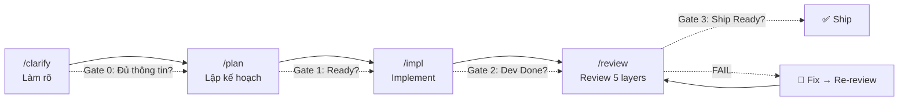
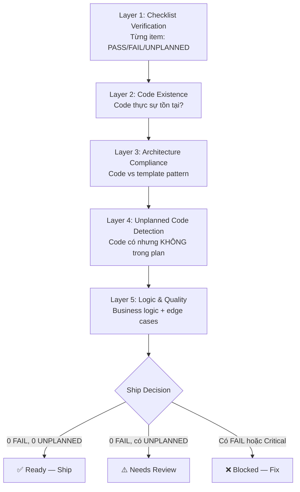
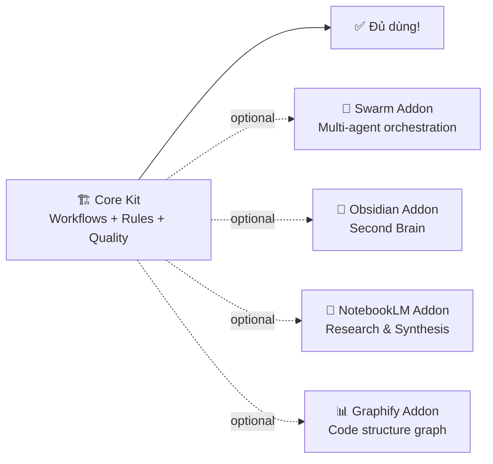
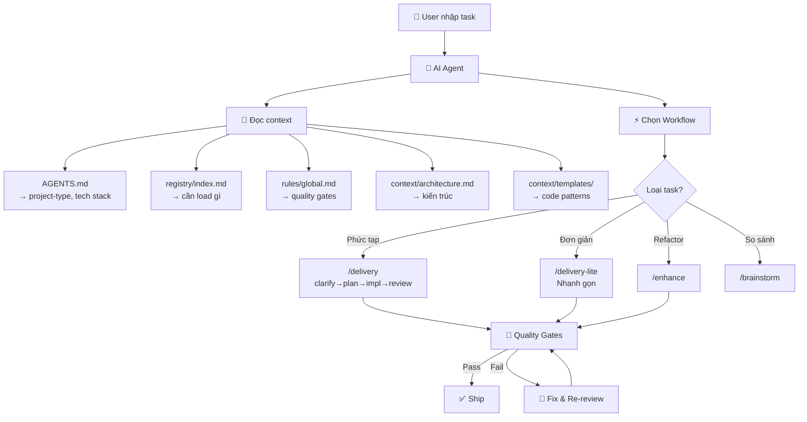

# 🤖 Universal Agent Kit — Cách hoạt động toàn bộ quy trình

## 1. Kiến trúc 3 tầng



**Tóm tắt:**

- **Tầng 1 (Core Kit):** Clone từ GitHub — chứa workflows, rules, quality gates. Dùng **chung** cho mọi project.
- **Tầng 2 (Project Layer):** Mỗi project tự tạo — chứa kiến trúc, templates, checklist **riêng** cho project đó.
- **Tầng 3 (Second Brain):** Tùy chọn — Obsidian vault lưu tri thức xuyên projects, NotebookLM research.

---

## 2. Luồng Agent khi nhận task



### Chi tiết từng bước:

| Bước | Agent làm gì    | File đọc                        | Mục đích                                             |
| ------ | ----------------- | --------------------------------- | ------------------------------------------------------- |
| 1      | Đọc passport    | `AGENTS.md`                     | Biết tên project, tech stack, reference modules       |
| 2      | Tra registry      | `registry/index.md`             | Biết project-type → cần load files nào              |
| 3      | Load rules        | `rules/global.md`               | Biết quality gates, guardrails, PROTECTED/OVERRIDABLE  |
| 4a     | Load architecture | `context/architecture.md`       | Biết kiến trúc, anti-patterns, naming conventions    |
| 4b     | Load templates    | `context/templates/be/` `fe/` | Biết code pattern chuẩn (ground truth để sinh code) |
| 4c     | Load checklist    | `context/checklist.md`          | Biết checklist items riêng của project               |
| 5      | Chọn workflow    | `workflows/*.md`                | Thực thi đúng flow cho loại task                    |

---

## 3. Workflow Flow (luồng chính)

### Flow đầy đủ: `/delivery`



### Flow rút gọn: `/delivery-lite`

```
clarify-lite (1-2 câu) → plan-lite (approach + files) → /impl → review-lite
```

### Các workflow khác

| Workflow           | Khi nào dùng                           |
| ------------------ | ---------------------------------------- |
| `/clarify`       | Task mơ hồ, cần hỏi đáp            |
| `/plan`          | Chốt approach + template selection      |
| `/impl`          | Code theo plan đã approved             |
| `/review`        | Review 5 layers với tri-state checklist |
| `/delivery`      | Full flow cho task phức tạp            |
| `/delivery-lite` | Shortcut cho task đơn giản            |
| `/enhance`       | Refactor/optimize có chủ đích        |
| `/brainstorm`    | So sánh options khi cần quyết định  |
| `/deploy`        | Deploy checklist                         |

---

## 4. Chi tiết từng Workflow

### 4.1. `/clarify` — Làm rõ requirements

```
Input:  User request (mơ hồ)
Output: Problem statement, scope in/out, risks, edge cases

Agent làm:
1. Hỏi đáp với user → lộ risk/edge cases
2. (Nếu cần) Scan codebase → hiểu pattern hiện tại
3. Xác định: API contract có đổi không?
4. Output: clarify-record
```

### 4.2. `/plan` — Lập kế hoạch

```
Input:  Output từ /clarify
Output: Approach, file list, template selection, quality card

Agent làm:
1. Xác định modules/files bị ảnh hưởng
2. Chọn template từ context/templates/
3. Tạo task breakdown theo thứ tự
4. Tạo Pre-Implementation Quality Card
5. Đánh giá API contract risk
```

> **Gate 1 — Ready:** Không code nếu thiếu problem statement, scope, plan, quality card.

### 4.3. `/impl` — Implement code

```
Input:  Plan đã approved
Output: Code changes, build result, self-check

Agent làm:
1. Load context (AGENTS.md, architecture.md, templates/)
2. Implement code BÁM SÁT template pattern
3. Self-check: đúng template? đúng naming? đúng error handling?
4. Build verification: dotnet build / npm run build
5. Build PASS → sang /review
   Build FAIL → fix, retry (max 3 lần)
```

> **Gate 2 — Dev Done:** Không review nếu build chưa pass, self-check chưa xong.

### 4.4. `/review` — Review 5 layers



> **Gate 3 — Ship Ready:** Blocked nếu còn Critical finding hoặc FAIL items chưa fix.

---

## 5. Hệ thống Rules (Quality Gates)

### Rules có 2 loại:

| Loại             | Ý nghĩa                                   | Override được?                          |
| ----------------- | ------------------------------------------- | ------------------------------------------ |
| `[PROTECTED]`   | Rule bắt buộc, KHÔNG ai override được | ❌ Không                                  |
| `[OVERRIDABLE]` | Rule mặc định, project CÓ THỂ override | ✅ Qua file `rule-overrides.approved.md` |

### Các nhóm rules:

| Nhóm                       | Loại       | Ví dụ                                                      |
| --------------------------- | ----------- | ------------------------------------------------------------ |
| **Delivery Gates**    | PROTECTED   | Không code nếu thiếu plan, không ship nếu còn Critical |
| **Bugfix Discipline** | PROTECTED   | Phải xác định root cause trước khi fix                 |
| **API Contract**      | PROTECTED   | Không thay đổi API contract ngoài scope                  |
| **Security**          | PROTECTED   | Không commit secrets, không chạy destructive commands     |
| **Architecture**      | OVERRIDABLE | Phân tầng rõ ràng (project có thể override)            |
| **Code Quality**      | OVERRIDABLE | i18n required, no debug logs, minimal change                 |
| **Checklist**         | OVERRIDABLE | Dùng master checklist 38 items (có thể subset)            |

### Luồng override:

```
1. Agent load rules/global.md
2. Agent load context/rule-overrides.approved.md (nếu có)
3. Với mỗi override:
   - Rule [PROTECTED] → ❌ Ignore override, log cảnh báo
   - Rule [OVERRIDABLE] → ✅ Apply override, log
4. Execute với merged rule set
```

---

## 6. Registry — Hỗ trợ nhiều loại project

File `registry/index.md` map `project-type` → files cần load:

| Project Type                     | Context cần                  | Templates           |
| -------------------------------- | ----------------------------- | ------------------- |
| `dotnet-clean-arch`            | architecture.md, checklist.md | templates/be/       |
| `react-vite`                   | architecture.md, checklist.md | templates/fe/       |
| `dotnet-clean-arch+react-vite` | architecture.md, checklist.md | templates/be/ + fe/ |
| `node-express`                 | architecture.md               | templates/be/       |
| `python-fastapi`               | architecture.md               | templates/be/       |
| `generic`                      | (none required)               | (none)              |
| ...                              | ...                           | ...                 |

**Mở rộng:** Thêm project type mới bằng cách thêm row vào bảng + tạo context files tương ứng.

---

## 7. Addons (Tùy chọn)



| Addon                 | Mô tả                                                   | Khi nào cần                  |
| --------------------- | --------------------------------------------------------- | ------------------------------ |
| **swarm/**      | Fan-out tasks cho nhiều agents (Codex, Gemini, OpenCode) | Khi dùng multi-agent setup    |
| **obsidian/**   | Obsidian vault lưu tri thức xuyên projects             | Khi muốn tích lũy knowledge |
| **notebooklm/** | 14 skills research & synthesis                            | Khi cần deep research         |
| **graphify/**   | Tự động tạo code structure graph                      | Khi muốn visualize codebase   |

---

## 8. Onboarding Project Mới (30 giây)

```
Bước 1: Clone kit
  git clone https://github.com/[repo]/agent-kit .agents

Bước 2: Copy template
  cp .agents/_project-template/AGENTS.md ./AGENTS.md

Bước 3: Điền AGENTS.md
  - project-type: dotnet-clean-arch (hoặc type phù hợp)
  - display-name: Tên project
  - tech stack: .NET, React...

Bước 4 (optional): Tạo context
  cp -r .agents/_project-template/.agents/context .agents/context
  → Điền architecture.md với kiến trúc project

Bước 5: Bắt đầu dùng!
  /clarify "Tôi muốn thêm feature X..."
```

---

## 9. Luồng dữ liệu tổng thể



---

## Tóm tắt: Tại sao hệ thống này hoạt động?

| Yếu tố               | Cơ chế                                                            |
| ---------------------- | ------------------------------------------------------------------- |
| **Consistency**  | Templates = ground truth. Agent luôn sinh code đúng pattern.     |
| **Quality**      | 3 gates bắt buộc + 38-item checklist + 5-layer review.            |
| **Flexibility**  | Rules OVERRIDABLE cho phép project customize mà không phá core. |
| **Scalability**  | Registry extensible — thêm project type mới dễ dàng.           |
| **IDE-agnostic** | Plain markdown files — bất kỳ AI agent đều đọc được.      |
| **Progressive**  | Core Kit đủ dùng. Addons chỉ bật khi thực sự cần.           |
