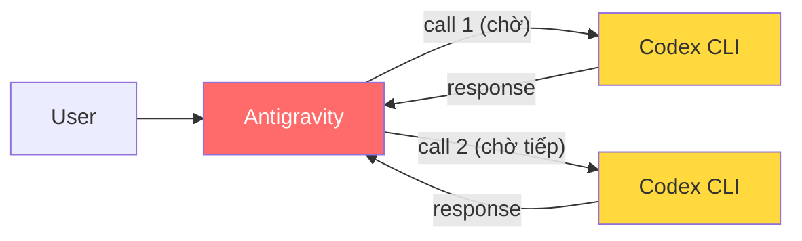
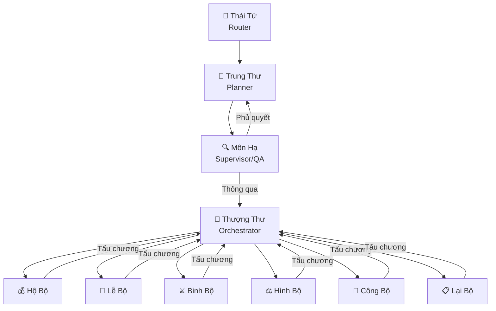
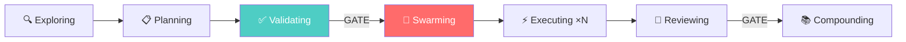
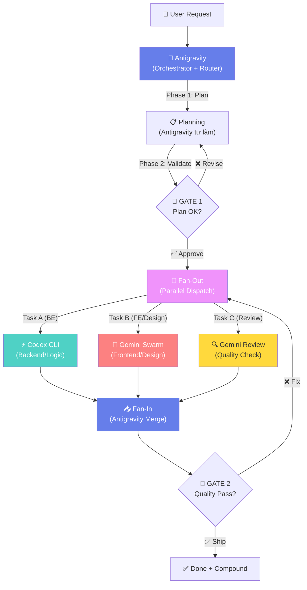

# 🏗️ Phân Tích Kiến Trúc Multi-Agent System

> **Nguồn dữ liệu:** 2 notebooks NotebookLM
>
> - **Build AI Agents** (14 sources) — Edict, Khuym, Cortex Hub, Codex Review
> - **Làm Chủ AI Agent: Khóa Học Toàn Diện 2026** (1 source) — Khóa học tổng hợp 7 pattern

---

## 1. Chẩn Đoán Vấn Đề Hiện Tại

> [!WARNING]
> **Bottleneck chính:** Antigravity hiện chỉ gọi được 1 MCP (codex-cli) → chạy tuần tự → đợi rất lâu → throughput thấp



**Vấn đề cụ thể:**

- ❌ **Serial execution** — mỗi lần chỉ 1 agent làm việc
- ❌ **Single point of bottleneck** — Antigravity phải chờ Codex xong mới tiếp tục
- ❌ **Không có quality gate** — thiếu bước review/validate
- ❌ **Không tận dụng parallel** — Gemini-swarm MCP có sẵn nhưng chưa dùng

---

## 2. Tổng Hợp 12 Kiến Trúc Từ 2 Notebook

### Ma Trận So Sánh Tổng Quan

| # | Kiến trúc                   |   Nguồn   |    Parallel    |  Quality Gate  |   Phức tạp   |    Chi phí    | Phù hợp với bạn |
| :-: | ----------------------------- | :---------: | :-------------: | :------------: | :------------: | :------------: | :-----------------: |
| 1 | 三省六部 (Edict)              | Build Agent |     ✅ Cao     |    ✅ Mạnh    |  🔴 Rất cao  | 🟡 Trung bình |       ⭐⭐⭐       |
| 2 | Khuym Pipeline + Swarm        | Build Agent |     ✅ Cao     |    ✅ Mạnh    | 🟡 Trung bình |    🟢 Thấp    |     ⭐⭐⭐⭐⭐     |
| 3 | Cortex Conductor              | Build Agent |     ✅ Cao     | ✅ 4D Scoring | 🟡 Trung bình | 🟡 Trung bình |      ⭐⭐⭐⭐      |
| 4 | Codex Parallel Review         | Build Agent |     ✅ Cao     |   ✅ Debate   |    🟢 Thấp    | 🟡 Trung bình |      ⭐⭐⭐⭐      |
| 5 | Multi-Agent MCP Orchestration |  Làm Chủ  |     ✅ Cao     |     🟡 Có     | 🟡 Trung bình |     🔴 Cao     |      ⭐⭐⭐⭐      |
| 6 | Stochastic Consensus          |  Làm Chủ  |   ✅ Rất cao   | ✅ Statistical | 🟡 Trung bình |     🔴 Cao     |        ⭐⭐        |
| 7 | Agent Chat Rooms (Debate)     |  Làm Chủ  |  🟡 Một phần  | ✅ Cross-check |    🟢 Thấp    | 🟡 Trung bình |       ⭐⭐⭐       |
| 8 | Sub-Agent Verification Loop   |  Làm Chủ  |  ❌ Tuần tự  | ✅ Fresh eyes |    🟢 Thấp    |    🟢 Thấp    |      ⭐⭐⭐⭐      |
| 9 | Multi-Agent Chrome MCP        |  Làm Chủ  | ✅ Tuyệt đối |   ❌ Không   | 🟡 Trung bình | 🟡 Trung bình |         ⭐         |
| 10 | Video-to-Action Pipeline      |  Làm Chủ  |  ❌ Tuần tự  |   ❌ Không   |    🟢 Thấp    |    🟢 Thấp    |         ⭐         |
| 11 | 60/30/10 Rule Routing         |  Làm Chủ  |     ✅ Có     |   🟡 Router   |    🟢 Thấp    | 🟢 Rất thấp |      ⭐⭐⭐⭐      |
| 12 | CrewAI/AutoGen Free-form      | Build Agent |     🟡 Có     |   ❌ Không   | 🟢 Rất thấp |    🟢 Thấp    |         ⭐         |

---

## 3. Phân Tích Chi Tiết Ưu Nhược Điểm

### 🏛️ Nhóm A: Heavy Orchestration (Kiến trúc nặng, phù hợp dự án lớn)

#### A1. 三省六部 Edict — 12 Agent System



| Tiêu chí               | Đánh giá                                                                                                                                                         |
| ------------------------ | ------------------------------------------------------------------------------------------------------------------------------------------------------------------- |
| **Ưu điểm**     | ✅ Quality gate mạnh nhất (Môn Hạ phủ quyết) · ✅ Audit trail đầy đủ · ✅ Real-time Kanban · ✅ 6 bộ chạy parallel · ✅ State machine bảo vệ flow |
| **Nhược điểm** | ❌ 12 agent quá nhiều cho team nhỏ · ❌ Vòng lặp kiểm duyệt chậm · ❌ Cần OpenClaw platform · ❌ Setup phức tạp                                       |
| **Khi nào dùng** | Dự án enterprise cần audit, bảo mật cao, team 5+ người                                                                                                       |

---

#### A2. Khuym — Staged Pipeline + Swarm



| Tiêu chí               | Đánh giá                                                                                                                                                                                            |
| ------------------------ | ------------------------------------------------------------------------------------------------------------------------------------------------------------------------------------------------------ |
| **Ưu điểm**     | ✅ Validate-first (không code khi chưa verify plan) · ✅ Swarm workers chạy parallel · ✅ CONTEXT.md khóa quyết định · ✅ Compounding học từ lần trước · ✅ Artifact handoff rõ ràng |
| **Nhược điểm** | ❌ Human Gates bắt buộc (chờ approve) · ❌ Overkill cho task nhỏ                                                                                                                                  |
| **Khi nào dùng** | **BEST FIT cho bạn** — phát triển phần mềm bằng AI agent team                                                                                                                             |

---

### 🔀 Nhóm B: Parallel Execution (Kiến trúc song song, tăng tốc)

#### B1. Multi-Agent MCP Orchestration (Router + Fan-out)

| Tiêu chí               | Đánh giá                                                                                                                                    |
| ------------------------ | ---------------------------------------------------------------------------------------------------------------------------------------------- |
| **Ưu điểm**     | ✅ Tận dụng thế mạnh riêng từng model (Gemini=FE, Codex=BE) · ✅ Build FE+BE cùng lúc · ✅ Cross-validation không ô nhiễm context |
| **Nhược điểm** | ❌ Tốn token/tiền API nhiều · ❌ Cần API keys nhiều platform                                                                             |
| **Khi nào dùng** | Full-stack app phức tạp, cần tối ưu từng phần trăm chất lượng                                                                       |

#### B2. Stochastic Multi-Agent Consensus (Fan-out → Statistical Fan-in)

| Tiêu chí               | Đánh giá                                                                                                    |
| ------------------------ | -------------------------------------------------------------------------------------------------------------- |
| **Ưu điểm**     | ✅ Quét search space khổng lồ · ✅ Lọc hallucination bằng thống kê · ✅ Tìm outlier ideas xuất sắc |
| **Nhược điểm** | ❌ Rất tốn token · ❌ Chỉ phù hợp ideation, không phù hợp coding                                      |
| **Khi nào dùng** | Brainstorm, phân tích chiến lược, quyết định high-confidence                                           |

#### B3. Cortex Conductor (Agent-to-Agent cross-IDE)

| Tiêu chí               | Đánh giá                                                                                                                                              |
| ------------------------ | -------------------------------------------------------------------------------------------------------------------------------------------------------- |
| **Ưu điểm**     | ✅ Agent tự tạo task cho nhau · ✅ Multi-IDE (Claude, Cursor, Antigravity, Codex) · ✅ Semantic memory chia sẻ · ✅ Session handoff có cấu trúc |
| **Nhược điểm** | ❌ Dependency chains chưa hoàn thiện (Planned) · ❌ Cần self-host infrastructure                                                                    |
| **Khi nào dùng** | Team dùng nhiều IDE/machine cùng lúc                                                                                                                 |

---

### 🛡️ Nhóm C: Quality Assurance (Kiến trúc đảm bảo chất lượng)

#### C1. Codex Parallel Review (Dual-Brain Debate)

| Tiêu chí                | Đánh giá                                                                                                |
| ------------------------- | ---------------------------------------------------------------------------------------------------------- |
| **Ưu điểm**      | ✅ 2 AI review độc lập + tranh luận · ✅ Bắt lỗi xuất sắc · ✅ Setup đơn giản (skill install) |
| **Nhược điểm**  | ❌ Tốn token gấp đôi · ❌ Chỉ cho review, không cho implement                                       |
| **Bạn đang có:** | `mcp:codex-cli` + `mcp:gemini-swarm` → **có thể làm ngay!**                                  |

#### C2. Sub-Agent Verification Loop (Implement → Review → Resolve)

| Tiêu chí                | Đánh giá                                                                                                  |
| ------------------------- | ------------------------------------------------------------------------------------------------------------ |
| **Ưu điểm**      | ✅ Fresh context review (không bias) · ✅ Bắt sunk-cost bias · ✅ Implement miễn phí trong Antigravity |
| **Nhược điểm**  | ❌ Serial (chậm) · ❌ Tốn thêm thời gian cho vòng lặp                                                 |
| **Bạn đang có:** | Antigravity tự implement → Codex review → Antigravity resolve                                             |

---

### 💰 Nhóm D: Cost Optimization

#### D1. 60/30/10 Rule Routing

| Tiêu chí                    | Đánh giá                                                                                          |
| ----------------------------- | ---------------------------------------------------------------------------------------------------- |
| **Ưu điểm**          | ✅ Tiết kiệm 60% token · ✅ Model routing thông minh · ✅ Chất lượng giảm không đáng kể |
| **Nhược điểm**      | ❌ Cần tuning tỷ lệ cho từng use case                                                            |
| **Áp dụng cho bạn:** | Gemini Flash cho scan/classify, Codex cho code tasks, Opus cho routing decisions                     |

---

## 4. 🎯 Meta-Flow Đề Xuất Cho Setup Hiện Tại

> [!IMPORTANT]
> **Kết hợp tinh hoa từ 4 kiến trúc phù hợp nhất:**
>
> - **Khuym** → Staged pipeline + validate-first
> - **Multi-Agent MCP Orchestration** → Parallel fan-out
> - **Codex Parallel Review** → Dual-brain quality check
> - **60/30/10 Routing** → Cost optimization

### Proposed Architecture: **Hybrid Orchestrator**



### Chi tiết từng Phase:

| Phase                     | Agent         | Chạy              | Mô tả                                                  |
| ------------------------- | ------------- | ------------------ | -------------------------------------------------------- |
| **1. Plan**         | Antigravity   | Solo               | Phân tích request, tạo implementation plan, chia task |
| **2. Validate**     | Antigravity   | Solo               | Self-check plan (GATE 1)                                 |
| **3. Fan-Out**      | Antigravity   | **PARALLEL** | Gửi task đồng thời cho Codex + Gemini Swarm          |
| **4a. Implement**   | Codex CLI     | Parallel           | Code backend, logic, tests                               |
| **4b. Implement**   | Gemini Swarm  | Parallel           | Code frontend, design, docs                              |
| **4c. Review**      | Gemini Review | Parallel           | Quality check song song                                  |
| **5. Fan-In**       | Antigravity   | Solo               | Merge kết quả, resolve conflicts                       |
| **6. Quality Gate** | Antigravity   | Solo               | Kiểm tra tổng thể (GATE 2)                            |
| **7. Compound**     | Antigravity   | Solo               | Lưu learnings cho lần sau                              |

### Cách implement ngay với tools hiện có:

```
Bạn đang có:
├── Antigravity (Gemini) → Orchestrator chính
├── mcp:codex-cli → Implementer (BE/logic)
├── mcp:gemini-swarm
│   ├── gemini_run_task → Implementer (FE/parallel tasks)
│   └── gemini_review_quality → Quality reviewer
└── mcp:notebooklm → Knowledge base
```

> [!TIP]
> **Cách chạy parallel ngay:**
>
> 1. Antigravity gọi `codex-cli` và `gemini_run_task` cùng lúc (không cần `waitForPreviousTools`)
> 2. Cả 2 chạy song song, Antigravity đợi cả 2 xong rồi merge
> 3. Sau merge, gọi `gemini_review_quality` để kiểm tra
> 4. Nếu FAIL → loop lại, nếu PASS → ship

---

## 5. So Sánh: Hiện Tại vs Đề Xuất

| Tiêu chí                      | Hiện tại (Serial) |     Đề xuất (Hybrid Parallel)     |
| ------------------------------- | :------------------: | :----------------------------------: |
| **Thời gian**            | ⏱️ T₁ + T₂ + T₃ |       ⏱️ max(T₁, T₂) + T₃       |
| **Tốc độ cải thiện** |          1x          |      **2-3x nhanh hơn**      |
| **Quality gate**          |      ❌ Không      |       ✅ 2 gates (Plan + Code)       |
| **Parallel tasks**        |          1          |            2-3 cùng lúc            |
| **Context pollution**     |        🔴 Cao        | 🟢 Thấp (mỗi agent context riêng) |
| **Cost**                  |       💰 Thấp       |           💰💰 Trung bình           |
| **Audit trail**           |      ❌ Không      |      ✅ Có (artifact handoff)      |

---

## 6. Anti-Patterns Cần Tránh

> [!CAUTION]
> Các sai lầm phổ biến khi build multi-agent system:

| ❌ Anti-Pattern                                            | ✅ Nên Làm                                                        |
| ---------------------------------------------------------- | ------------------------------------------------------------------- |
| Để agents tự do chat rồi nộp kết quả (CrewAI style) | Có quality gate bắt buộc ở mỗi phase                           |
| Để agent sau tự suy luận lại ý định                | Khóa quyết định vào CONTEXT.md/artifact cố định             |
| Dùng TODO list tĩnh quản lý state                      | Dùng live work graphs hoặc task.md có status tracking            |
| Nhồi tất cả vào 1 prompt khổng lồ                    | Phân tầng: Instructions → Knowledge → Prompt                    |
| Dùng model đắt nhất cho mọi task                      | 60/30/10 routing: Flash cho scan, Sonnet cho code, Opus cho routing |
| Agent tự review chính nó                                | Fresh-context reviewer (Sub-Agent Verification Loop)                |
| Chạy tất cả tuần tự                                   | Fan-out tasks không phụ thuộc nhau chạy parallel                |

---

## 7. Roadmap Triển Khai

### Phase 1: Quick Win (Làm ngay hôm nay)

- [X] Xác định bottleneck (serial execution)
- [ ] Cấu hình Antigravity gọi parallel: `codex-cli` + `gemini_run_task` cùng lúc
- [ ] Thêm `gemini_review_quality` sau mỗi implement cycle
- [ ] Tạo CONTEXT.md template cho mỗi task

### Phase 2: Structured Flow (Tuần này)

- [ ] Implement Khuym-style staged pipeline (Plan → Validate → Execute → Review)
- [ ] Tạo workflow `.agents/workflows/parallel-implement.md`
- [ ] Cấu hình 60/30/10 routing cho task classification

### Phase 3: Full Team Agent (Tháng này)

- [ ] Tích hợp Cortex Hub Conductor (nếu self-host)
- [ ] Agent-to-agent task creation
- [ ] Shared memory (NotebookLM as knowledge base)
- [ ] Compound learning loop

---

## 8. Kết Luận

> [!IMPORTANT]
> **Kiến trúc tối ưu cho bạn = Khuym Pipeline + Multi-Agent Fan-out + Quality Gate**
>
> Lý do:
>
> 1. **Khuym** cho flow có kiểm soát (validate-first, không code mù)
> 2. **Fan-out** cho tốc độ (Codex + Gemini chạy parallel)
> 3. **Quality Gate** cho chất lượng (gemini_review_quality)
> 4. **60/30/10** cho chi phí (không dùng model đắt cho task rẻ)
>
> Kết quả kỳ vọng: **Tốc độ 2-3x, chất lượng tăng nhờ review, chi phí hợp lý**
>
