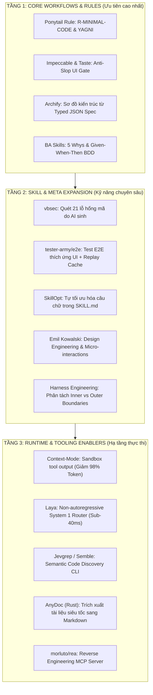

# Kế Hoạch Tích Hợp Tri Thức Deep Research Vào Agent-Dev-Kit (ADK)

> **Ngày lập:** 2026-10-16  
> **Nguồn trích xuất:** Hội thoại [[Deep Research And Repo Classification]](conversation://6c1f60fb-5a17-43d4-87ae-256212fcb967)  
> **Cơ sở dữ liệu liên kết:** Obsidian Second Brain (`01_Wiki/01_AI_Agents/MASTER_RESEARCH_CLASSIFICATION_INDEX.md`)  
> **Trạng thái:** Kế hoạch hành động chính thức (Approved Blueprint)

---

## 🎯 1. Triết Lý Định Hướng & Tiêu Chuẩn Chọn Lọc (Core Principles)

### 1.1. Bản chất cốt lõi của Agent-Dev-Kit
Agent-Dev-Kit là **Tầng 1 (Core Meta-Kit)**:
- Không phải là ứng dụng nghiệp vụ hay sản phẩm thương mại cụ thể.
- Là bộ khung quy chuẩn (`workflows/`), hàng rào kiểm soát chất lượng (`rules/global.md`), thư viện kỹ năng (`skills/`), và mẫu quy ước (`templates/`) giúp AI Coding Agent lập trình nhất quán, chuẩn pattern và không gây trôi dạt ngữ cảnh (context drift).

### 1.2. Tiêu chuẩn chọn lọc & Nguyên tắc bài trừ
1. **Loại bỏ triệt để các ứng dụng nghiệp vụ cụ thể:**
   - Các công cụ như *OCR CCCD (CaoAnhNato)*, *AnythingLLM*, *Pixelle-Video*, *Meetily*, *Concat*... là sản phẩm ứng dụng tầng cuối (End-user Apps). Việc đưa trực tiếp chúng vào Core Kit sẽ gây phình to (bloatware) và gây ô nhiễm domain (domain contamination).
2. **Tập trung vào "Cương ngựa" (Harnessing) & Năng lực vận hành của Agent:**
   - Chỉ tích hợp các công nghệ và phương pháp luận giải quyết 4 điểm nghẽn sống còn của AI Coding Agents:
     - **Chống Overengineering:** Ép agent viết code tối giản, tuân thủ YAGNI, không tự ý đẻ abstraction.
     - **Chống Generic AI Slop:** Thiết lập bản hợp đồng thẩm mỹ UI/UX, chặn các giao diện màu mè vô nghĩa.
     - **Tiết kiệm Token & Chống ngộ độc ngữ cảnh:** Giảm 90–98% token từ stdout terminal và tìm kiếm code theo ngữ nghĩa.
     - **Kiểm soát An ninh & Chất lượng:** Quét các lỗ hổng chuyên biệt của mã do AI sinh và kiểm thử E2E tự thích ứng.

---

## ⚖️ 2. Đối Chiếu & So Sánh Hai Phương Án Tích Hợp

| Tiêu chí | Phương Án A (Phân Tích Toàn Cảnh) | Phương Án B (Tinh Gọn Phân Tầng Tác Động) |
| :--- | :--- | :--- |
| **Phạm vi tiếp cận** | **Bao quát toàn diện:** Tìm vị trí tích hợp cho gần như toàn bộ 70+ nguồn trong 6 trụ cột nghiên cứu. | **Chắt lọc có điều kiện (Laser-focused):** Chỉ tập trung vào năng lực cốt lõi của Coding Agent; gạt bỏ sản phẩm nghiệp vụ. |
| **Cấu trúc phân loại** | Theo cấu trúc thư mục vật lý của repo (`rules/`, `workflows/`, `skills/`, `runtime/`, `registry/`, `addons/`). | Theo mức độ ảnh hưởng thực chiến (`Tầng 1: Core Gates` → `Tầng 2: Skills` → `Tầng 3: Runtime Tools`). |
| **Phạm vi mở rộng** | Rộng: Đăng ký cả Project-Type `enterprise-rag`, cào web `agent-reach`, MCP DBX. | Gọn: Đánh trúng 4 bài toán: Overengineering, UI Slop, Context Bloat, AI Security. |
| **Nguy cơ phình Kit** | **Trung bình - Cao:** Dễ biến ADK thành một kho lưu trữ cồng kềnh. | **Rất thấp:** Giữ Core Kit thanh thoát, dễ bảo trì, đúng chuẩn Meta-Kit. |
| **Tính khả thi thực thi** | Cần lộ trình dài hơi qua nhiều sprints. | **Có thể triển khai ngay lập tức** trong 1 phiên làm việc. |

> **Quyết định chốt:** Sử dụng **Phương Án B** làm **Khung Hành Động Cốt Lõi (Execution Blueprint)**, đồng thời đưa 2 hạng mục giá trị cao của Phương Án A (Database Read-Only MCP và Enterprise RAG Blueprint) vào **Hàng đợi mở rộng (Backlog Expansion)**.

---

## 🏛️ 3. Bản Đồ 3 Tầng Tích Hợp Vào Core Kit (Chi Tiết)

---

### 🌟 TẦNG 1: TÍCH HỢP TRỰC TIẾP VÀO CORE WORKFLOWS & RULES (ƯU TIÊN CAO NHẤT)

Đây là những cơ chế tác động trực tiếp vào tư duy, hành vi và chốt chặn an toàn của Agent trong các workflow nền tảng (`/wf-clarify`, `/wf-plan`, `/wf-impl`, `/wf-review`).

#### 1. [DietrichGebert/ponytail](https://github.com/DietrichGebert/ponytail) — Anti-Overengineering Rule
- **Vị trí tích hợp:** `rules/global.md` (Nhóm 3: General Principles) & `skills/core/sk-doubt-critic/SKILL.md`.
- **Cơ chế áp dụng:**
  - Thiết lập rule bắt buộc **`R-MINIMAL-CODE` (Ponytail Rule) [PROTECTED]**.
  - Triết lý: *"Đoạn code tốt nhất là đoạn code không phải viết"*.
  - Ràng buộc:
    - Bắt buộc agent luôn tìm giải pháp đơn giản nhất bằng tính năng có sẵn (built-in) của ngôn ngữ/framework.
    - Cấm tự ý thêm middleware, utility wrapper, base classes hoặc design pattern trừ khi có ít nhất 3 use cases thực tế hoặc có chỉ định rõ từ người dùng.
    - Ưu tiên refactor và xóa code thừa trước khi viết mới.

#### 2. [pbakaus/impeccable](https://github.com/pbakaus/impeccable) + [Leonxlnx/taste-skill](https://github.com/Leonxlnx/taste-skill) — Anti-Slop UI Gate
- **Vị trí tích hợp:** `rules/global.md` & `templates/DESIGN.md.template`.
- **Cơ chế áp dụng:**
  - Thiết lập tiêu chuẩn **Anti-Slop Frontend Gate** trong `rules/global.md`:
    - Cấm triệt để các cliché của AI: cấm lạm dụng nền gradient tím/neon vô tội vạ, cấm dùng font mặc định không có chủ đích, cấm bo góc và đổ bóng quá đà.
    - Bắt buộc tuân thủ tỷ lệ tương phản chuẩn WCAG 2.1 AA.
  - Cung cấp file mẫu `templates/DESIGN.md.template` định nghĩa rõ ràng: Typography scales, Color Palette (Hex), Spacing Tokens, và Animation Physics để làm căn cứ review code UI.

#### 3. [tt-a1i/archify](https://github.com/tt-a1i/archify) — Chuẩn Hóa Kiến Trúc Bằng Typed JSON Spec
- **Vị trí tích hợp:** `workflows/wf-plan.md` & `addons/archify/SKILL.md`.
- **Cơ chế áp dụng:**
  - Chuẩn hóa bước lập sơ đồ hệ thống trong `/wf-plan`: Thay vì để agent tự vẽ sơ đồ Mermaid tự do (dễ sinh ảo giác nối sai service), agent sẽ gọi addon `archify` chính chủ để:
    1. Trích xuất bằng chứng (Evidence) từ repo thực tế.
    2. Xuất Typed JSON Spec (Single Source of Truth).
    3. Validate schema và biên dịch ra HTML tương tác, hỗ trợ review diff chuẩn xác trên Git Pull Request.

#### 4. [phong-baruby/ba-skills](https://github.com/phong-baruby/ba-skills) — Kỹ Thuật 5 Whys & Acceptance Criteria Chuẩn BDD
- **Vị trí tích hợp:** `workflows/wf-clarify.md` & `skills/core/sk-agile-ba/SKILL.md`.
- **Cơ chế áp dụng:**
  - Làm sạch `sk-agile-ba` (loại bỏ các ví dụ đặc thù ngành Biomass để đảm bảo tính generic).
  - Tích hợp kỹ thuật chất vấn **"5 Whys Elicitation"** để bóc tách yêu cầu tiềm ẩn và kiểm tra Solution Bias của người dùng.
  - Chuẩn hóa đầu ra: User Story đạt 6 tiêu chí **INVEST** và Acceptance Criteria bắt buộc viết theo định dạng **Gherkin (Given-When-Then)** cho cả Happy Path và Boundary Edge Cases.

---

### 🚀 TẦNG 2: MỞ RỘNG KỸ NĂNG CHUYÊN SÂU & TIẾN HÓA KIT (SKILL & META EXPANSION)

Bổ sung các chốt chặn kiểm thử, an ninh và tự hoàn thiện chính ADK (`/wf-test`, `/wf-security`, `/wf-evolve`).

#### 1. [tanviet12/vbsec](https://github.com/tanviet12/vbsec) — Quét 21 Lỗ Hổng Của Mã Nguồn Do AI Sinh
- **Vị trí tích hợp:** `skills/security/sk-owasp-scan/SKILL.md` & `workflows/wf-security.md`.
- **Cơ chế áp dụng:**
  - Nâng cấp `sk-owasp-scan` từ OWASP Top 10 truyền thống lên bộ kiểm tra toàn diện, bổ sung checklist 21 lỗ hổng phổ biến nhất của AI:
    - *Hallucinated package imports* (nguy cơ tấn công Typosquatting vào dependencies không tồn tại).
    - *Indirect Prompt Injection* qua xử lý file upload hoặc dữ liệu RAG.
    - *Hardcoded test tokens / mock credentials* mà agent quên xóa.
    - *Permissive CORS & Insecure Deserialization* trong mã scaffold mẫu.
    - *Server-Side Request Forgery (SSRF)* trong logic gọi webhook/API do AI tự sinh.

#### 2. [tester-army/e2e](https://github.com/tester-army/e2e) — Kiểm Thử E2E Thích Ứng Giao Diện
- **Vị trí tích hợp:** `skills/testing/sk-scenario-generator/SKILL.md` & `workflows/wf-test.md`.
- **Cơ chế áp dụng:**
  - Đưa nguyên lý kiểm thử bằng mục tiêu tự nhiên (*Goal-Oriented Assertion*) vào `sk-scenario-generator`.
  - Khắc phục nhược điểm flaky tests của Playwright/Cypress truyền thống: AI agent tự dò lại element khi UI thay đổi DOM/CSS nhỏ, và lưu kịch bản thành công vào **Replay Cache** để chạy lại với chi phí token = 0.

#### 3. [microsoft/SkillOpt](https://github.com/microsoft/SkillOpt) — Tối Ưu Hóa Câu Chữ Trong SKILL.md
- **Vị trí tích hợp:** `skills/meta/sk-skill-synthesizer/SKILL.md` & `workflows/wf-evolve.md`.
- **Cơ chế áp dụng:**
  - Áp dụng phương pháp phân tích trajectory từ các phiên làm việc thành công/thất bại để tự động tinh chỉnh câu chữ chỉ dẫn trong các file `SKILL.md` của ADK.
  - Sử dụng cơ chế *Validation-Gated Updates* để đảm bảo kỹ năng sau khi tinh chỉnh luôn đạt hiệu suất cao hơn phiên bản trước.

#### 4. [emilkowalski/skills](https://github.com/emilkowalski/skills) — Design Engineering Checklist
- **Vị trí tích hợp:** `skills/core/sk-execution-contract/SKILL.md` (Frontend Projects).
- **Cơ chế áp dụng:**
  - Bổ sung checklist kỹ nghệ giao diện chuẩn studio: Tinh chỉnh chuyển động vật lý (spring curves thay cho linear), responsive tap targets (tối thiểu 44x44px trên mobile), layout shifting prevention, và semantic a11y.

#### 5. [revfactory/harness](https://github.com/revfactory/harness) + [learn-harness](https://github.com/walkinglabs/learn-harness-engineering) — Ranh Giới Inner & Outer Harness
- **Vị trí tích hợp:** `addons/swarm/` & `agents/`.
- **Cơ chế áp dụng:**
  - Định nghĩa rõ: **Inner Harness** (quy định hành vi, memory và failure budget nội tại của từng subagent) và **Outer Harness** (hệ thống bus giao tiếp, protocol bàn giao, và chốt chặn an toàn giữa các subagent).

---

### ⚡ TẦNG 3: CÔNG CỤ HẠ TẦNG & TỐI ƯU RUNTIME (RUNTIME & TOOLING ENABLERS)

Các giải pháp MCP Server và CLI giúp agent chạy nhanh hơn, giảm tiêu thụ token và tránh ngộ độc ngữ cảnh.

| Công Cụ / Repo | Vai Trò Hỗ Trợ ADK | Giá Trị Đo Đếm Được |
| :--- | :--- | :--- |
| **[mksglu/context-mode](https://github.com/mksglu/context-mode)** | Tích hợp qua MCP Control-Plane | **Giảm 98% token tiêu thụ:** Tự động sandbox các output terminal nặng (`git log`, `npm test`, `cargo build`), chỉ trả về bản tóm tắt súc tích + ID tham chiếu; triệt tiêu hoàn toàn nguy cơ ngộ độc ngữ cảnh. |
| **[NandhaKishorM/laya](https://github.com/NandhaKishorM/laya)** | Tích hợp vào Router của ADK / Swarm | **Phân luồng Sub-40ms (System 1):** Định tuyến nhanh chóng user prompt vào đúng workflow (`/wf-clarify`, `/wf-plan`, `/wf-fix`) hoặc kiểm tra guardrail nhị phân (yes/no) mà không tốn chi phí gọi LLM autoregressive. |
| **[dzhng/jevgrep](https://github.com/dzhng/jevgrep)** & **[Semble](https://github.com/MinishLab/semble)** | Công cụ bổ trợ cho `/wf-research` | **Semantic Code Search CLI:** Cho phép agent tìm kiếm code bằng câu hỏi ngôn ngữ tự nhiên thay vì grep thô, giảm 98% token nạp vào context. |
| **[firecrawl/anydoc](https://github.com/firecrawl/anydoc)** | Engine cho `sk-document-parser` | **Chuyển đổi tài liệu sang Markdown bằng Rust:** Đọc và làm sạch các tài liệu Word, Excel, PPTX, PDF của khách hàng trong vài mili-giây để đưa vào `/wf-clarify`. |
| **[morluto/rea](https://github.com/morluto/rea)** | Skill bổ trợ cho `/wf-research` | **Reverse Engineering MCP:** Phân tích ứng dụng mẫu hoặc thư viện nhị phân để rút trích cấu trúc logic khi thực hiện task phỏng dựng/tái lập tính năng. |

---

## 📦 4. Danh Mục Mở Rộng Dự Bị (Backlog Expansion — Từ Phương Án A)

Những hạng mục này sẽ được triển khai khi mở rộng các dự án chuyên biệt hoặc phát triển addons:

1. **Bổ sung Project-Type `enterprise-rag` vào `registry/index.md`:**
   - Dựa trên thảo luận cộng đồng Mì AI & Tencent WeKnora: Chuẩn hóa kiến trúc RAG doanh nghiệp gồm 6 tầng (OCR chuyên dụng → Adaptive Chunking → Hybrid Search Dense+BM25 → Cross-Encoder Reranker → RBAC Filter → Ground-truth Citation Guardrail).
2. **Nâng cấp `addons/database` với Physical Safety Layer (từ [t8y2/dbx](https://github.com/t8y2/dbx)):**
   - Đưa vào chế tài Read-Only bắt buộc qua MCP cho 40+ database engines, ngăn chặn tuyệt đối tình trạng agent tự ý drop bảng hoặc chạy lệnh update ngoài scope.
3. **Tích hợp Web Scraping 0đ API (từ [Panniantong/agent-reach](https://github.com/Panniantong/agent-reach) & [crawl4ai](https://github.com/unclecode/crawl4ai)):**
   - Nâng cấp `skills/research/sk-web-cleaner` giúp agent cào dữ liệu từ X, Reddit, GitHub, YouTube mà không tốn phí API.

---

## 🛠️ 5. Lộ Trình Triển Khai (Action Items)

| Bước | Mục tiêu thực hiện | File tác động | Trạng thái |
| :---: | :--- | :--- | :---: |
| **1** | **Bổ sung Ponytail Rule (Anti-Overengineering)** | `rules/global.md` | ✅ Done |
| **2** | **Anti-Slop UI Gate (Impeccable + Taste)** | `rules/global.md`, `templates/DESIGN.md.template` | ⏳ Deferred |
| **3** | **Cập nhật 21 Lỗ hổng AI Security (vbsec)** | `skills/security/sk-owasp-scan/SKILL.md` | ✅ Done |
| **4** | **Làm sạch & Nâng cấp BA Skill (5 Whys + BDD)** | `skills/core/sk-agile-ba/SKILL.md`, `workflows/wf-clarify.md` | ✅ Done |
| **5** | **Chuẩn hóa Archify Gate vào Planning** | `workflows/wf-plan.md` | ❌ Skipped |

---
*Tài liệu được tổng hợp và chuẩn hóa theo tiêu chuẩn kiến trúc Agent-Dev-Kit v0.6.0.*
*Cập nhật lần cuối: 2026-10-16.*
