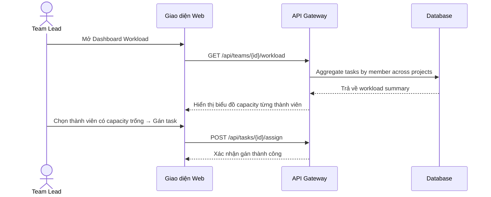

# Agile Business Analysis — adk-agile-ba

## 🎯 Mục tiêu
Giúp PO/BA tự động hóa quá trình phân tích nghiệp vụ, làm mịn yêu cầu thô từ khách hàng thành các tài liệu kỹ thuật sẵn sàng bàn giao cho đội ngũ Phát triển (Dev) và Kiểm thử (QA).

---

## ⚙️ Quy Trình Thực Thi Của Agent

### Bước 1: Tiếp nhận & Thử thách yêu cầu (5 Whys Elicitation)

1. **Nhận yêu cầu thô** từ khách hàng / stakeholder.
2. **Kiểm tra Solution Bias:** Xác định xem user đang mô tả *vấn đề cần giải quyết*
   hay đang đề xuất *một giải pháp cụ thể có sẵn trong đầu*.
   - Nếu là giải pháp → Hỏi ngược: *"Vấn đề gốc mà bạn đang cố giải quyết là gì?"*
3. **Chạy vòng lặp 5 Whys** (tối đa 5 vòng, dừng sớm nếu đã rõ):
   - Vòng 1: *"Tại sao tính năng này cần thiết?"* → Xác định giá trị nghiệp vụ.
   - Vòng 2: *"Tại sao quy trình hiện tại chưa đáp ứng?"* → Lộ pain point gốc.
   - Vòng 3: *"Tại sao pain point này chưa được xử lý?"* → Lộ ràng buộc kỹ thuật/tổ chức.
   - Vòng 4–5: Đào sâu thêm nếu câu trả lời vẫn mơ hồ hoặc chứa giả định ngầm.
4. **Đánh giá rủi ro nghiệp vụ theo domain của project:**
   - Đọc `AGENTS.md` và `.agents/context/` để hiểu domain-specific risks.
   - Liệt kê các rủi ro nghiệp vụ đặc thù (dữ liệu, quy trình, compliance) liên quan
     đến yêu cầu đang phân tích.

### Bước 2: Thiết lập PRD & Phác thảo Quy trình
*   Tạo tài liệu PRD (Product Requirements Document).
*   **BẮT BUỘC vẽ sơ đồ nghiệp vụ:** Sử dụng **Mermaid** trực tiếp trong Markdown. Không vẽ bằng JSON Canvas.
    - Dùng `graph TD` cho quy trình nghiệp vụ.
    - Dùng `sequenceDiagram` cho luồng tương tác hệ thống.

### Bước 3: Tính điểm RICE để ưu tiên tính năng
Lập bảng tính RICE Score cho các tính năng đề xuất:
$$RICE = \frac{Reach \times Impact \times Confidence}{Effort}$$
*   **Reach (Mức độ tiếp cận):** Số người dùng hoặc số giao dịch/tháng.
*   **Impact (Mức độ tác động):** Điểm từ 0.25 (Thấp) đến 3 (Rất cao).
*   **Confidence (Độ tin cậy):** Điểm phần trăm từ 50% đến 100%.
*   **Effort (Công sức triển khai):** Tính bằng Man-months.

### Bước 4: Viết User Story chuẩn INVEST & AC Gherkin
Bẻ Epic thành các User Stories nguyên tử:
*   **INVEST Check:** Đảm bảo đủ 6 tiêu chí (Independent, Negotiable, Valuable, Estimable, Small, Testable).
*   **Acceptance Criteria (AC):** Viết theo định dạng **Gherkin (Given-When-Then)** cho cả Happy Path và Unhappy/Edge Cases.

---

## 📖 Ví dụ mẫu: Tính năng gán Task tự động (SaaS Task Management)

### 5 Whys Trace:
| Vòng | Câu hỏi | Câu trả lời |
|:---:|:---|:---|
| 1 | Tại sao cần tính năng gán task tự động? | Team lead mất 30 phút mỗi sáng để phân việc thủ công. |
| 2 | Tại sao phân việc thủ công mất lâu? | Phải kiểm tra workload từng thành viên trên nhiều board. |
| 3 | Tại sao thông tin workload phân tán? | Hệ thống chưa aggregate workload cross-project. |
| **Root** | **→ Vấn đề gốc:** Thiếu dashboard workload tổng hợp, không phải thiếu tính năng auto-assign. |

### User Story:
**As a** Team Lead  
**I want to** xem dashboard workload tổng hợp của tất cả thành viên trong team  
**So that** tôi có thể phân công task nhanh chóng dựa trên capacity thực tế.

### Mermaid Diagram:

### Acceptance Criteria:
*   **AC1: Hiển thị workload tổng hợp (Happy Path)**
    - **Given** Team Lead đã đăng nhập và team có 5 thành viên đang hoạt động
    - **When** Team Lead mở Dashboard Workload
    - **Then** hệ thống hiển thị danh sách thành viên kèm số task đang In Progress, tổng story points và phần trăm capacity đã sử dụng.
*   **AC2: Thành viên không có task nào (Edge Case)**
    - **Given** thành viên "Nguyễn A" chưa được gán bất kỳ task nào trong sprint hiện tại
    - **When** Team Lead mở Dashboard Workload
    - **Then** hệ thống hiển thị "Nguyễn A" với 0 tasks, 0 story points, capacity 0% và badge "Available".
*   **AC3: Gán task cho thành viên đã quá tải (Edge Case)**
    - **Given** thành viên "Trần B" đã sử dụng 100% capacity (8/8 story points)
    - **When** Team Lead chọn gán thêm task (3 SP) cho "Trần B"
    - **Then** hệ thống hiển thị cảnh báo "Thành viên đã vượt capacity. Bạn có muốn tiếp tục?" với nút Xác nhận và Hủy.
