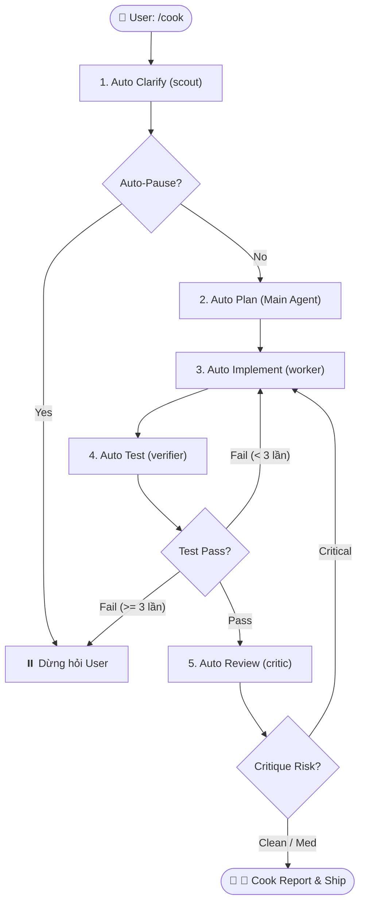

# Autonomous Cooking Pipeline — adk-cook

> Kế thừa tinh hoa của `/cook` truyền thống, được tái cấu trúc hoàn toàn theo kiến trúc **4 Specialist Subagents & Proof-First Gates (v0.9.0)**.
> Triết lý cốt lõi: *"Let him cook"* — nhận yêu cầu 1 lệnh duy nhất, tự chủ vận hành vòng lặp khép kín, triệt tiêu câu hỏi lắt nhắt, chỉ dừng lại khi gặp blocker kiến trúc hoặc đã sẵn sàng ship với đầy đủ bằng chứng thực thi.

---

## 🎯 Mục tiêu & Khi nào dùng

- **Mục tiêu:** Trao toàn quyền tự chủ cho AI Agent giải quyết trọn gói một task từ đầu đến cuối mà không làm phiền developer giữa chừng.
- **Khi nào dùng:**
  - Triển khai tính năng mới đã có ý định rõ ràng.
  - Sửa lỗi phức tạp đi qua nhiều tầng (Multi-layer bugfix).
  - Tái cấu trúc module (Refactoring) kèm nâng cấp test suite.
  - Khi developer muốn tập trung làm việc khác và quay lại nhận thành phẩm đã qua kiểm định.
- **Không dùng khi:**
  - Brainstorm ý tưởng mở (hãy dùng `adk-brainstorm`).
  - Task chưa rõ bài toán nghiệp vụ cốt lõi (hãy dùng `adk-business-discovery`).
  - Thao tác có rủi ro phá hủy dữ liệu (drop database, deploy production, xóa migration cũ).

---

## ⚡ Modifiers (Cờ điều khiển hành vi)

> [!IMPORTANT]
> **MẶC ĐỊNH THỰC THI INLINE (R-INLINE-FIRST):** Nhằm tối ưu hóa token và triệt tiêu độ trễ, Main Agent **mặc định tự mình thực thi cả 5 bước inline** trong cùng phiên chat (tự khảo sát CodeGraph, tự lập plan, tự sửa code, tự chạy test, tự rà diff). Tuyệt đối **KHÔNG** tự ý spawn subagent trừ khi có cờ --subagents hoặc yêu cầu rõ ràng từ Developer.

| Modifier | Tác dụng | Khi nào nên dùng |
|---|---|---|
| --subagents | Ủy quyền phân tán cho specialist subagents chạy độc lập (tốn thêm token & độ trễ) | Khi cần cô lập context hoàn toàn hoặc tác vụ đa module cực lớn |
| --fast | Rút gọn quy trình: bỏ artifact trung gian, scout nhanh, thực thi trực tiếp, chạy test tối thiểu | Bug nhỏ, thay đổi giao diện nhỏ, prototype |
| --tdd | Bắt buộc viết test đỏ trước (Red -> Green -> Refactor), kiểm tra assertion chặt chẽ | Logic tính toán, xử lý nghiệp vụ cốt lõi, API endpoints |
| --no-review | Bỏ qua bước Critic đối kháng độc lập, chỉ giữ lại bước test build/test | Task nội bộ ít rủi ro, refactor không đổi contract |
| --no-test | Bỏ qua bước chạy test tự động | Dự án chưa có test runner hoặc task thuần tài liệu/cấu hình |
---

## 🔄 Quy Trình 5 Bước Tự Động (The 5-Step Cooking Loop)



### Bước 1: Auto Clarify (`scout`)
- Scout nạp context bằng CodeGraph (`codegraph_explore` / `codegraph_callers`) và đọc `AGENTS.md`.
- Tự giải quyết các khoảng trống bằng conventions sẵn có của codebase thay vì ngắt quãng hỏi user.
- Nêu giả định nhỏ, an toàn và tiếp tục tiến trình.

### Bước 2: Auto Plan (`Main Agent`)
- Thiết lập kế hoạch phẫu thuật tối thiểu (Minimal Change Principle).
- Xác định phạm vi file cần tác động (`files_changed`), blast radius và lệnh kiểm chứng mục tiêu (`verified_cmd`).
- Nếu `--fast`: lập plan tóm tắt trong bộ nhớ, không tạo execution contract dài dòng.

### Bước 3: Auto Implement (`worker`)
- Worker thực thi sửa đổi chính xác theo phạm vi được giao.
- Nếu có cờ `--tdd`: viết failing test trước, sửa code tối thiểu để pass, dọn sạch code thừa (Ponytail Rule).
- Không tự ý refactor ngoài phạm vi được chỉ định.

### Bước 4: Auto Test (`verifier`)
- Verifier độc lập thực thi kiểm định xác định: build, typecheck, linter và unit test suite.
- Chạy domain scanners tương ứng: `ui_slop_auditor.py` cho UI, `vbsec_scanner.py` cho auth/API.
- Áp dụng Fail-Closed Gate: chỉ cấp `ADMIT` khi có lệnh chạy thực tế và 100% pass.

### Bước 5: Auto Review (`critic`) — Bỏ qua nếu có `--no-review`
- Critic kích hoạt 4 lăng kính đối kháng: Security, Data/State, API Contract, Scale/Performance.
- Bẻ gãy giả định ngầm; nếu phát hiện rủi ro mức CRITICAL/HIGH, hoàn trả Worker khắc phục ngay lập tức.

---

## ⏸️ Auto-Pause Conditions (Điều kiện ngắt an toàn)

Agent **BẮT BUỘC** dừng quy trình và yêu cầu user xác nhận khi gặp 1 trong 4 trường hợp sau:
1. **Thiếu quyết định nghiệp vụ cốt lõi:** Có nhiều hướng đi mâu thuẫn trực tiếp với mục tiêu sản phẩm mà không có căn cứ trong codebase.
2. **Xung đột kiến trúc (Architecture Conflict):** Code thực tế mâu thuẫn sâu sắc với spec hoặc yêu cầu đòi hỏi phá vỡ API contract hiện hành.
3. **Vòng lặp sửa lỗi thất bại (Infinite Repair Loop):** Verifier báo fail $\ge 3$ lần liên tiếp trên cùng một nguyên nhân lỗi mà Worker không giải quyết được.
4. **Hành động có rủi ro cao ngoài ý muốn:** Cần drop database table, xóa vĩnh viễn dữ liệu, hoặc push code lên production remote.

---

## 📋 Hợp Đồng Đầu Ra Bắt Buộc (`🍳 Cook Report`)

Khi hoàn thành mọi bước kiểm định, Agent xuất báo cáo tổng kết theo đúng mẫu:

```markdown
## 🍳 Cook Report
- **status:** SHIP | BLOCKED | NEEDS_DECISION
- **task:** <Tóm tắt yêu cầu ban đầu>
- **applied_modifiers:** <None | --fast | --tdd | --no-review | --no-test>

### 🛠️ Thay đổi mã nguồn
| File (`path:line`) | Hành động | Tóm tắt kỹ thuật |
|---|---|---|
| `src/services/order.ts:45-80` | Modify | Thêm logic tính toán chiết khấu |
| `tests/services/order.test.ts:1-60` | Add | Bổ sung unit test coverage cho happy path & edge cases |

### 🧪 Executable Verification
- **verified_cmd:** `<Lệnh kiểm chứng thật>` -> `PASS (<số test pass>, 0 warnings)`
- **verifier_verdict:** `ADMIT`
- **critic_status:** `PASS (0 critical, 0 high risks)`

### 🚢 Ship Decision
- **Sẵn sàng commit/merge:** ✅ CÓ
- **Rủi ro còn lại (Open Risks):** NONE
```
