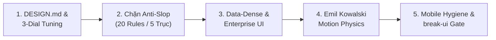

# UI Craftsmanship & Anti-Slop Discipline — adk-ui-craft

## 🎯 Mục tiêu

Đảm bảo mọi mã nguồn giao diện đạt chuẩn **Studio-Grade (Impeccable 20/20)**, triệt tiêu hoàn toàn cảm giác "AI Slop". Agent đóng vai trò **Senior Design Engineer**, kết hợp chặt chẽ thẩm mỹ thương mại, vật lý chuyển động Emil Kowalski, kỷ luật Mobile-Native và Accessibility (WCAG 2.2).

---

## 🚀 Quy Trình Thực Thi 5 Bước



### Bước 1: Nạp `DESIGN.md` & Cơ chế 3-Dial Parametric Tuning (`taste-skill`)
1. Đọc `DESIGN.md` tại root dự án hoặc `.agents/context/DESIGN.md` (khởi tạo từ `templates/DESIGN.md.template` nếu chưa có).
2. Trích xuất Design Tokens (Colors, Typography, Radius) và **3 thông số điều hướng thẩm mỹ (thang 1–10)**:
   - **`DESIGN_VARIANCE` (1–10):** `1–3` chuẩn mực/đối xứng (Enterprise/Admin); `4–6` cân bằng hiện đại (SaaS); `7–10` bất đối xứng/editorial (Landing/Creative).
   - **`MOTION_INTENSITY` (1–10):** `1–3` tĩnh/tức thời; `4–6` vi tương tác tinh tế (`150ms–200ms`); `7–10` choreographed spring physics.
   - **`VISUAL_DENSITY` (1–10):** `1–3` thoáng đãng nhiều whitespace; `4–6` chuẩn ứng dụng; `7–10` mật độ cao (Cockpit/Financial/Data Table).

### Bước 2: Kiểm soát & Chặn đứng "AI UI Slop" (Aesthetics & Copywriting)
- ❌ **Cấm dải màu tím-xanh mặc định (`BAN-01`):** Không dùng `from-purple-600 to-blue-600` hoặc neon gradient ngẫu hứng.
- ❌ **Cấm Raw Emoji trong UI control (`BAN-02`):** Không nhét `🚀`, `✨`, `🔥`, `💡` vào `<button>`, `<a>`, `<Badge>`, `<h1-h3>`. Dùng SVG icon `1.5px` stroke (Lucide, Heroicons, Radix).
- ❌ **Cấm Nút "Viên thuốc dài" (`BAN-04`):** Tránh `rounded-full px-12`; ưu tiên `rounded-md` hoặc `rounded-lg` cân xứng (`px-4 py-2`).
- ❌ **Cấm Font AI Slop (`BAN-05`):** Không dùng `Space Grotesk`, `Syne`, `Outfit`, `Sora` cho UI nghiệp vụ; ưu tiên `Inter`, `Geist`, `Plus Jakarta Sans`.
- ❌ **Cấm Viền xám đặc trên nền tối (`BAN-07`):** Không dùng `dark:border-gray-700`/`slate-800` đặc; phải dùng viền bán trong suốt `border-white/10` hoặc `dark:border-slate-700/50`.
- ❌ **Cấm Lazy Comment & AI Cliché (`BAN-08`):** Cấm để lại `// ... rest of` hoặc văn mẫu sáo rỗng (`Unleash the power`, `Supercharge your workflow`).

### Bước 3: Giao diện Dữ liệu Nghiệp vụ (Enterprise Data-Dense)
- **Căn chỉnh số liệu (`DAT-01`):** Mọi cột tiền tệ (`$`, `₫`, `VND`), phần trăm (`%`), số lượng, ngày tháng trong `<td>` phải có `tabular-nums` hoặc `font-mono` và căn phải (`text-right`).
- **Bảo vệ tràn bảng (`DAT-02`):** Mọi thẻ `<table>` bắt buộc bọc trong container có `overflow-x-auto`.
- **Đủ 4 trạng thái dữ liệu:** Skeleton loading, Empty state có CTA rõ ràng, Error state có nút thử lại, và xử lý tràn chữ bằng `truncate` kèm `title`.

### Bước 4: Vật lý Chuyển động & Vi tương tác (Emil Kowalski Motion Physics)
- **Phân biệt đường cong Enter vs Exit (`MOT-01`):** Khi phần tử xuất hiện (`enter`/`animate-in`/modal/popover) bắt buộc dùng `ease-out` (`cubic-bezier(0.16, 1, 0.3, 1)`), khi đóng/thoát (`exit`) dùng `ease-in`. Cấm dùng `ease-in` khi mở modal/popover.
- **Cấm phóng từ hư không (`BAN-06`):** Modal/Popover mở từ `scale(0.95)` (`scale-95 opacity-0`) lên `scale(1)`, tuyệt đối cấm `scale-0` / `scale(0)`.
- **Bảo toàn 60fps (`MOT-02`, `MOT-03`):** Cấm `transition-all` hoặc animate `width/height/top/left` gây layout thrashing; chỉ animate `transform` và `opacity`. Thời lượng micro-interaction trên nút/input giữ ở `150ms–200ms` (cấm `duration-500`/`700`/`1000`), thông số Spring chuẩn: `stiffness: 400, damping: 30`.
- **Tactile & Reduced Motion (`MOT-04`):** Nút bấm có `active:scale-[0.98]`. Mọi animation lặp (`animate-spin/ping/bounce`, `@keyframes`) phải đi kèm `motion-reduce:` hoặc `@media (prefers-reduced-motion: reduce)`.
- **Focus & Semantics (`BAN-03`, `A11Y-01..03`):** Cấm `outline-none` thiếu `focus-visible:ring-2`; cấm `<div onClick>` thiếu `role`/`tabIndex`; nút chỉ có icon phải có `aria-label`; `` phải có `alt`.

### Bước 5: Kỷ luật Mobile-Native Hygiene & `break-ui` Stress Test
- **Chống iOS Safari Auto-Zoom (`MOB-01`):** Mọi `<input>`, `<textarea>`, `<select>` phải có font-size $\ge 16\text{px}$ trên mobile (`text-base sm:text-sm`), cấm dùng `text-xs`/`text-sm` đơn độc.
- **Dynamic Viewport (`MOB-02`):** Dùng `100dvh`, `h-dvh`, `min-h-dvh` thay vì `100vh` hoặc `h-screen` để không bị thanh địa chỉ mobile che khuất.
- **Zero Overflow & Touch Target (`MOB-03`):** Cấm gán cứng `w-[400px..999px]` không có prefix responsive (`sm:`/`md:`/`max-w-full`). Diện tích chạm tối thiểu đạt **$44 \times 44\text{px}$**.
- **Thử thách `break-ui`:** Tự kiểm tra giao diện với tên dài 100 ký tự không khoảng trắng, con số hàng tỷ (`999,999,999,999 ₫`), mảng 0 phần tử và màn hình hẹp **320px**.

---

## 🔌 Các Công Cụ MCP (`ui-design` Addon — Khi Bật)

| Tool MCP | Công dụng chính |
|---|---|
| `search_design_archetypes` | Tra cứu bộ mẫu thiết kế ngành dọc, bảng màu và cấu hình 3-Dial gợi ý |
| `get_design_tokens` | Xuất hệ thống biến CSS/Tailwind chuẩn từ Archetype hoặc `DESIGN.md` |
| `get_component_blueprint` | Lấy khung mã chuẩn chống Slop cho Table, Modal, Form, Bento, Navigation |
| `verify_color_contrast` | Tính toán tỷ lệ tương phản WCAG 2.2 AA/AAA và gợi ý mã màu thay thế |
| `audit_ui_code` | Quét mã nguồn theo 20 Rules (5 trục) và chấm điểm Impeccable 20/20 |
| `fix_ui_slop` | Tự động sửa nhanh các lỗi UI Slop & Mobile Hygiene phổ biến |
| `scaffold_design_contract` | Khởi tạo file `DESIGN.md` hoàn chỉnh cho dự án mới |

---

## ⚙️ Deterministic Auditor CLI (`scripts/ui_slop_auditor.py`)

Trước khi báo hoàn tất (`READY`), bắt buộc chạy trình kiểm định tĩnh độc lập (stdlib-only, chấm điểm **Impeccable 20/20** trên 5 trục `AESTHETICS`, `MOTION`, `A11Y`, `MOBILE`, `DATA_DENSE`):

```powershell
# Quét kiểm định nghiêm ngặt, xuất JSON hoặc tự động sửa lỗi cơ bản (--fix)
py -B .agents/skills/adk-ui-craft/scripts/ui_slop_auditor.py <paths> --strict
py -B .agents/skills/adk-ui-craft/scripts/ui_slop_auditor.py <paths> --fix --json
# Hoặc chạy qua CLI của ui-design addon (nếu đã cài đặt)
node addons/ui-design/mcp-server/index.js audit <paths> --strict
```
