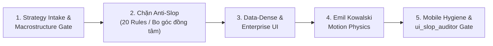

# UI Craftsmanship & Anti-Slop Discipline — adk-ui-craft

## 🎯 Mục tiêu

Đảm bảo mọi mã nguồn giao diện đạt chuẩn **Studio-Grade (Impeccable 20/20)**, triệt tiêu hoàn toàn cảm giác "AI Slop". Agent đóng vai trò **Senior Design Engineer**, kết hợp chặt chẽ chiến lược chuyển đổi, đa dạng hóa khung xương qua **21 Macrostructures**, kỷ luật bo góc đồng tâm, vật lý chuyển động Emil Kowalski, chuẩn Mobile-Native và Accessibility (WCAG 2.2).

---

## 🕹️ Bộ 4 Động Từ Vận Hành (Operating Verbs)

Agent xác định đúng ý định của người dùng để kích hoạt động từ tương ứng:

1. **`build` (Mặc định khi code mới/thêm feature):**
   - Đọc brief $\rightarrow$ Làm rõ Strategy Intake $\rightarrow$ Chọn 1 Macrostructure $\rightarrow$ Áp tokens từ `DESIGN.md` $\rightarrow$ Chạy kiểm định $\rightarrow$ Bàn giao mã.
2. **`audit` (Chế độ Read-Only Tuyệt Đối):**
   - Kích hoạt khi người dùng yêu cầu: *"soi lỗi UI"*, *"kiểm tra giao diện"*, *"audit trang này"*.
   - **RÀNG BUỘC CỨNG:** Agent **tuyệt đối không gọi tool `edit_file` hoặc `write_file`** để sửa code.
   - Chỉ chạy `ui_slop_auditor.py`, xuất bảng danh sách lỗi (Punch-List) phân cấp 🔴 P0, 🟡 P1, 🟢 P2 và dừng lại chờ Developer phê duyệt.
3. **`redesign` (Bảo toàn 100% Nghiệp vụ, Thay đổi Giao diện):**
   - Kích hoạt khi làm mới UI cũ bị dính Slop.
   - Giữ nguyên 100% logic API, database queries, state management, form handlers và copywriting. Chỉ đập đi xây lại cấu trúc layout và styling theo Macrostructure mới.
4. **`study` (Bóc tách Design DNA):**
   - Kích hoạt khi người dùng đưa link mẫu hoặc ảnh chụp màn hình UI xuất sắc.
   - Bóc tách tỷ lệ vàng khoảng cách, hierarchy font chữ, nhịp điệu layout $\rightarrow$ lưu thành tokens tham chiếu, cấm copy mã máy móc.

---

## 🚀 Quy Trình Thực Thi 5 Bước



### Bước 1: Strategy Intake, Macrostructure Selection & 3-Dial Tuning
1. **Strategy & Conversion Intake (Kỷ luật Elaya Part A):** Trước khi code landing page/view chính, làm rõ 4 câu hỏi:
   - *Core Offer:* Giá trị định lượng cụ thể mang lại trong 1 câu là gì?
   - *ICP:* Ai là người trực tiếp trả tiền / sử dụng hàng ngày?
   - *Top Objections:* Nỗi sợ hoặc rào cản mua hàng lớn nhất cần giải quyết trên trang?
   - *Primary CTA:* 1 hành động chuyển đổi duy nhất tối thượng.
2. **Macrostructure Selection Gate (Kỷ luật Hallmark):**
   - Bắt buộc chọn **1 trong 21 Macrostructures** phù hợp với loại sản phẩm (chi tiết ở bảng mục 6).
   - ❌ **CẤM mặc định bố cục rập khuôn:** *Navbar $\rightarrow$ Hero căn giữa kèm gradient tím $\rightarrow$ 3 feature cards chia đều $\rightarrow$ Pricing 3 cột*.
3. **Đọc `DESIGN.md` & Điều phối 3-Dial Parametric Tuning (`taste-skill`):**
   - **`DESIGN_VARIANCE` (1–10):** `1–3` chuẩn mực/đối xứng; `4–6` SaaS hiện đại; `7–10` bất đối xứng/editorial.
   - **`MOTION_INTENSITY` (1–10):** `1–3` tĩnh/tức thời; `4–6` micro-interactions (`150ms–200ms`); `7–10` spring physics.
   - **`VISUAL_DENSITY` (1–10):** `1–3` thoáng đãng; `4–6` chuẩn ứng dụng; `7–10` cockpit dữ liệu dày đặc.

### Bước 2: Kiểm soát & Chặn đứng "AI UI Slop" (Aesthetics & Geometry)
- ❌ **Cấm dải màu tím-xanh mặc định (`BAN-01`):** Không dùng `from-purple-600 to-blue-600` hoặc neon gradient ngẫu hứng.
- ❌ **Cấm Raw Emoji trong UI control (`BAN-02`):** Không nhét `🚀`, `✨`, `🔥`, `💡` vào `<button>`, `<a>`, `<Badge>`, `<h1-h3>`. Dùng SVG icon `1.5px` stroke (Lucide, Heroicons, Radix).
- ❌ **Cấm Nút "Viên thuốc dài" (`BAN-04`):** Tránh `rounded-full px-12`; ưu tiên `rounded-md` hoặc `rounded-lg` cân xứng (`px-4 py-2`).
- ❌ **Cấm Font AI Slop (`BAN-05`):** Không dùng `Space Grotesk`, `Syne`, `Outfit`, `Sora` cho UI nghiệp vụ; ưu tiên `Inter`, `Geist`, `Plus Jakarta Sans`.
- ❌ **Cấm Viền xám đặc trên nền tối (`BAN-07`):** Không dùng `dark:border-gray-700`/`slate-800` đặc; phải dùng viền bán trong suốt `border-white/10` hoặc `dark:border-slate-700/50`.
- ❌ **Cấm Lazy Comment & AI Cliché (`BAN-08`):** Cấm để lại `// ... rest of` hoặc văn mẫu sáo rỗng (`Unleash the power`, `Supercharge your workflow`).
- ❌ **Cấm Bo góc Lệch tâm Quang học (`BAN-09`):** Phần tử con lồng trong thẻ cha có padding $< 32\text{px}$ **bắt buộc tuân thủ công thức bo góc đồng tâm**:
  $$R_{\text{con}} = R_{\text{cha}} - \text{Padding}$$
  *(Ví dụ: Cha có `rounded-2xl` 16px, `p-2` 8px thì con bắt buộc là `rounded-lg` 8px; cấm con cùng cỡ hoặc lớn hơn cha)*.

### Bước 3: Giao diện Dữ liệu Nghiệp vụ (Enterprise Data-Dense)
- **Căn chỉnh số liệu (`DAT-01`):** Mọi cột tiền tệ (`$`, `₫`, `VND`), phần trăm (`%`), số lượng, ngày tháng trong `<td>` phải có `tabular-nums` hoặc `font-mono` và căn phải (`text-right`).
- **Bảo vệ tràn bảng (`DAT-02`):** Mọi thẻ `<table>` bắt buộc bọc trong container có `overflow-x-auto`.
- **Đủ 4 trạng thái dữ liệu:** Skeleton loading, Empty state có CTA rõ ràng, Error state có nút thử lại, và xử lý tràn chữ bằng `truncate` kèm `title`.

### Bước 4: Vật lý Chuyển động & Vi tương tác (Emil Kowalski Motion Physics)
- **Phân biệt đường cong Enter vs Exit (`MOT-01`):** Khi phần tử xuất hiện (`enter`/`animate-in`/modal/popover) bắt buộc dùng `ease-out` (`cubic-bezier(0.16, 1, 0.3, 1)`), khi đóng/thoát (`exit`) dùng `ease-in`. Cấm dùng `ease-in` khi mở modal/popover.
- **Cấm phóng từ hư không (`BAN-06`):** Modal/Popover mở từ `scale(0.95)` (`scale-95 opacity-0`) lên `scale(1)`, tuyệt đối cấm `scale-0` / `scale(0)`.
- **Bảo toàn 60fps (`MOT-02`, `MOT-03`):** Cấm `transition-all` hoặc animate `width/height/top/left` gây layout thrashing; chỉ animate `transform` và `opacity`. Thời lượng micro-interaction trên nút/input giữ ở `150ms–200ms` (cấm `duration-500`/`700`/`1000`), thông số Spring chuẩn: `stiffness: 400, damping: 30`.
- **Tactile & Reduced Motion (`MOT-04`):** Nút bấm có `active:scale-[0.98]`. Mọi animation lặp (`animate-spin/ping/bounce`, `@keyframes`) phải đi kèm `motion-reduce:` hoặc `@media (prefers-reduced-motion: reduce)`.
- **Focus & Semantics (`BAN-03`, `A11Y-01..03`):** Cấm `outline-none` thiếu `focus-visible:ring-2`; cấm `<div onClick>` thiếu `role`/`tabIndex`; nút chỉ có icon phải có `aria-label`; `` phải có `alt`.

### Bước 5: Kỷ luật Mobile-Native Hygiene & `break-ui` Stress Test
- **Chống iOS Safari Auto-Zoom (`MOB-01`):** Mọi `<input>`, `<textarea>`, `<select>` phải có font-size $\ge 16\text{px}$ trên mobile (`text-base sm:text-sm`), cấm dùng `text-xs`/`text-sm` đơn độc.
- **Dynamic Viewport (`MOB-02`):** Dùng `100dvh`, `h-dvh`, `min-h-dvh` thay vì `100vh` hoặc `h-screen` để không bị thanh địa chỉ mobile che khuất.
- **Zero Overflow & Touch Target (`MOB-03`):** Cấm gán cứng `w-[400px..999px]` không có prefix responsive (`sm:`/`md:`/`max-w-full`). Diện tích chạm tối thiểu đạt **$44 \times 44\text{px}$**.
- **Thử thách `break-ui`:** Tự kiểm tra giao diện với tên dài 100 ký tự không khoảng trắng, con số hàng tỷ (`999,999,999,999 ₫`), mảng 0 phần tử và màn hình hẹp **320px**.

---

## 🔌 Các Công Cụ MCP (`ui-design` Addon — Khi Bật)

| Tool MCP | Công dụng chính |
|---|---|
| `search_design_archetypes` | Tra cứu bộ mẫu thiết kế ngành dọc, bảng màu và cấu hình 3-Dial gợi ý |
| `get_design_tokens` | Xuất hệ thống biến CSS/Tailwind chuẩn từ Archetype hoặc `DESIGN.md` |
| `get_component_blueprint` | Lấy khung mã chuẩn chống Slop cho Table, Modal, Form, Bento, Navigation |
| `verify_color_contrast` | Tính toán tỷ lệ tương phản WCAG 2.2 AA/AAA và gợi ý mã màu thay thế |
| `audit_ui_code` | Quét mã nguồn theo 20 Rules (5 trục) và chấm điểm Impeccable 20/20 |
| `fix_ui_slop` | Tự động sửa nhanh các lỗi UI Slop & Mobile Hygiene phổ biến |
| `scaffold_design_contract` | Khởi tạo file `DESIGN.md` hoàn chỉnh cho dự án mới |

---

## ⚙️ Deterministic Auditor CLI (`scripts/ui_slop_auditor.py`)

Trước khi báo hoàn tất (`READY`), bắt buộc chạy trình kiểm định tĩnh độc lập (stdlib-only, chấm điểm **Impeccable 20/20** trên 5 trục `AESTHETICS`, `MOTION`, `A11Y`, `MOBILE`, `DATA_DENSE`):

```powershell
# Quét kiểm định nghiêm ngặt, xuất JSON hoặc tự động sửa lỗi cơ bản (--fix)
py -B .agents/skills/adk-ui-craft/scripts/ui_slop_auditor.py <paths> --strict
py -B .agents/skills/adk-ui-craft/scripts/ui_slop_auditor.py <paths> --fix --json
# Hoặc chạy qua CLI của ui-design addon (nếu đã cài đặt)
node addons/ui-design/mcp-server/index.js audit <paths> --strict
```

---

## 🏛️ Danh Mục 21 Macrostructures Tham Chiếu (Hallmark Anti-Slop)

Khi thực hiện Bước 1, Agent chọn 1 Macrostructure phù hợp với sản phẩm từ danh mục dưới đây:

| Mã | Tên Macrostructure | Bản chất Bố cục | Ứng dụng Mục tiêu |
|:---:|---|---|---|
| **M-01** | **Bento Grid** | Các khối module bất đối xứng ($2\times1, 1\times2, 2\times2$) ghép lại. | Dashboard SaaS, System Features |
| **M-02** | **Long Document** | Trình bày dạng văn bản tài liệu liên tục với mục lục phụ bên cạnh. | DevTools, Research Memo |
| **M-03** | **Marquee Hero** | Tiêu đề áp đảo toàn bộ nếp gấp đầu tiên ($>72\text{px}$). | Launching, Tiêu dùng, Creative |
| **M-04** | **Stat-Led** | Đặt 1 con số dữ liệu hoặc chỉ số KPI cốt lõi làm tâm điểm. | FinTech, Cloud Infra, Data B2B |
| **M-05** | **Workbench** | Giao diện mô phỏng IDE, Canvas hoặc Terminal tương tác thực tế. | AI Sandbox, Code Editors, API Client |
| **M-06** | **Conversational FAQ** | Khung trang được dẫn dắt bằng chuỗi đối thoại hoặc hỏi-đáp tương tác. | Dịch vụ tư vấn, Sản phẩm phức tạp |
| **M-07** | **Manifesto** | Thuần văn bản triết lý với typography đậm nét, triệt tiêu card màu mè. | Open Source, Indie Brand |
| **M-08** | **Photographic** | Lấy hình ảnh thực tế chất lượng cao làm chủ đạo dẫn dắt thị giác. | Phần cứng, E-commerce, Studio |
| **M-09** | **Quote-Led** | Trích dẫn đánh giá thực tế của khách hàng (Testimonial) làm trục dẫn chuyện. | Agency, B2B Social Proof |
| **M-10** | **Specimen** | Bố cục dạng "Bảng thông số kỹ thuật", chia ngăn rõ ràng, chính xác. | Thiết bị IoT, Thư viện phần mềm |
| **M-11** | **Catalogue** | Dạng danh mục kho hàng phân tầng, có filter bên trái và thẻ bên phải. | Plugin store, Thư viện mẫu |
| **M-12** | **Letter** | Bức thư ngỏ chân thành từ nhà sáng lập kèm chữ ký tay và ghi chú lề. | Khởi nghiệp Early-stage, Blog cá nhân |
| **M-13** | **Index-First** | Mục lục danh bạ trung tâm, nhấp vào đâu bung dữ liệu chi tiết tại đó. | Documentation Portal, Wiki |
| **M-14** | **Narrative Workflow** | Kể chuyện tuyến tính theo 3–4 bước người dùng trải nghiệm. | Workflow Automation, Onboarding |
| **M-15** | **Split Studio** | Màn hình chia đôi: Một bên ghim demo tương tác, một bên cuộn mô tả. | Portfolio, Live Product Demo |
| **M-16** | **Feature Stack** | Các thẻ tính năng xếp chồng và dính chặt (sticky stack) khi cuộn. | Mobile App, 3–4 Core Features |
| **M-17** | **Type Specimen** | Tôn vinh nghệ thuật sắp chữ với các kích cỡ font chữ tương phản cực mạnh. | Font foundry, Tạp chí thiết kế |
| **M-18** | **Portfolio Grid** | Lưới trưng bày tác phẩm với nhịp điệu sole, khoảng cách thoáng đãng. | Design Agency, Nhiếp ảnh |
| **M-19** | **Map / Diagram** | Sơ đồ tương tác hoặc bản đồ kiến trúc hệ thống nằm ở vị trí trung tâm. | Bản đồ mạng, Cloud Architecture |
| **M-20** | **Ecosystem Index** | Bảng ma trận kết nối và logo tích hợp chứng minh tính tương thích. | API Integration, Payments |
| **M-21** | **Component Playground**| Cho phép người dùng kéo slider và test trực tiếp tính năng trên Hero. | UI Library, SDKs, Shader Tools |
