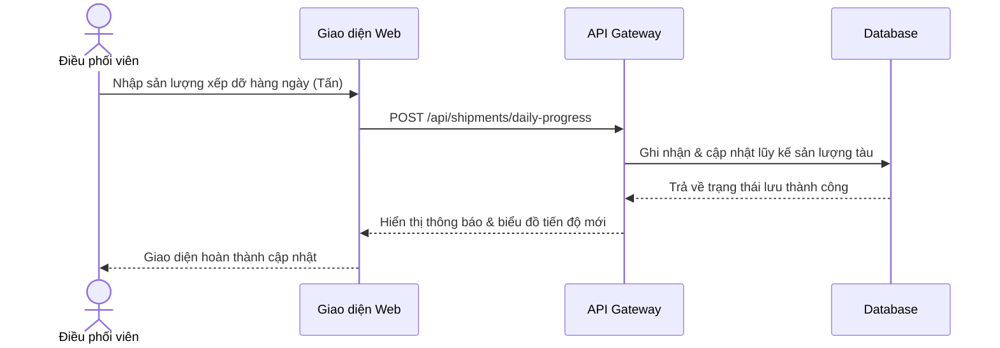

# Agile Business Analysis — sk-agile-ba

## 🎯 Mục tiêu
Giúp PO/BA tự động hóa quá trình phân tích nghiệp vụ, làm mịn yêu cầu thô từ khách hàng thành các tài liệu kỹ thuật sẵn sàng bàn giao cho đội ngũ Phát triển (Dev) và Kiểm thử (QA).

---

## ⚙️ Quy Trình Thực Thi Của Agent

### Bước 1: Tiếp nhận & Thử thách yêu cầu (Product Discovery)
*   Nhận yêu cầu thô (ví dụ: file văn bản thu thập từ Obsidian clipping).
*   Thử thách yêu cầu (Ask Why) để phát hiện **Solution Bias** (thiên lệch giải pháp).
*   Đánh giá rủi ro nghiệp vụ đặc thù của ngành **Cung ứng Sinh khối (Biomass)**:
    - Rủi ro gian lận/chênh lệch khối lượng tại trạm cân.
    - Sai lệch tỷ lệ độ ẩm (Moisture) và tạp chất (Impurity).
    - Độ trễ đồng bộ dữ liệu giữa các kho vệ tinh và cảng biển.

### Bước 2: Thiết lập PRD & Phác thảo Quy trình
*   Tạo tài liệu PRD (Product Requirements Document) trong `01_Wiki/`.
*   **BẮT BUỘC vẽ sơ đồ nghiệp vụ:** Sử dụng **Mermaid** trực tiếp trong Markdown. Không vẽ bằng JSON Canvas.
    - Dùng `graph TD` cho quy trình nghiệp vụ.
    - Dùng `sequenceDiagram` cho luồng tương tác hệ thống.

### Bước 3: Tính điểm RICE để ưu tiên tính năng
Lập bảng tính RICE Score cho các tính năng đề xuất:
$$RICE = \frac{Reach \times Impact \times Confidence}{Effort}$$
*   **Reach (Mức độ tiếp cận):** Số người dùng hoặc số giao dịch/tháng.
*   **Impact (Mức độ tác động):** Điểm từ 0.25 (Thấp) đến 3 (Rất cao).
*   **Confidence (Độ tin cậy):** Điểm phần trăm từ 50% đến 100%.
*   **Effort (Công sức triển khai):** Tính bằng Man-months.

### Bước 4: Viết User Story chuẩn INVEST & AC Gherkin
Bẻ Epic thành các User Stories nguyên tử:
*   **INVEST Check:** Đảm bảo đủ 6 tiêu chí (Independent, Negotiable, Valuable, Estimable, Small, Testable).
*   **Acceptance Criteria (AC):** Viết theo định dạng **Gherkin (Given-When-Then)** cho cả Happy Path và Unhappy/Edge Cases.

---

## 📖 Ví dụ nghiệp vụ Biomass mẫu: Cập nhật sản lượng xếp dỡ Tàu (Ship Plan)

### User Story:
**As a** Điều phối viên Cảng (Port Coordinator)  
**I want to** cập nhật sản lượng xếp dỡ hàng ngày của từng tàu lên hệ thống  
**So that** quản lý cảng và khách hàng có thể theo dõi tiến độ Ship Plan thời gian thực.

### Mermaid Diagram:

### Acceptance Criteria:
*   **AC1: Cập nhật thành công sản lượng hàng ngày (Happy Path)**
    - **Given** điều phối viên đã đăng nhập và đang mở màn hình chi tiết Ship Plan của tàu "TL_BIOMASS_01"
    - **And** tàu đang ở trạng thái "Đang xếp dỡ" (Loading)
    - **When** người dùng nhập sản lượng ngày hôm nay là "2,500" tấn và xác nhận lưu
    - **Then** hệ thống ghi nhận sản lượng lũy kế, cập nhật phần trăm hoàn thành tiến độ và hiển thị thông báo "Cập nhật sản lượng thành công".
*   **AC2: Sản lượng vượt quá tải trọng tối đa của tàu (Edge Case)**
    - **Given** tàu "TL_BIOMASS_01" có tải trọng định mức là 50,000 tấn và sản lượng xếp dỡ lũy kế hiện tại là 49,000 tấn
    - **When** người dùng nhập sản lượng ngày hôm nay là "2,000" tấn (lũy kế vượt mức 1,000 tấn) và xác nhận lưu
    - **Then** hệ thống từ chối cập nhật và hiển thị cảnh báo lỗi: "Sản lượng lũy kế không được vượt quá tải trọng định mức của tàu (50,000 tấn)".
