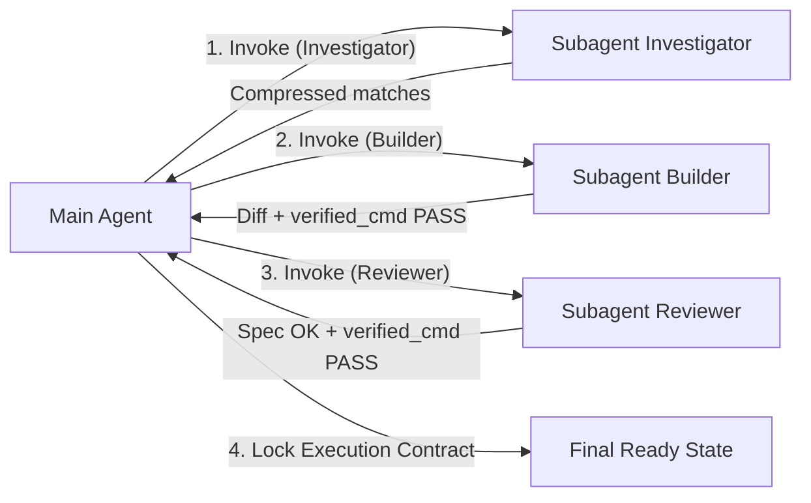

# Compressed Subagent Delegation — Cavecrew Protocol & Proof-First Gates

> Phóng tác và nâng cấp từ mô hình `cavecrew` trong [`JuliusBrussee/caveman`](https://github.com/JuliusBrussee/caveman).
> Giải quyết đồng thời 2 bài toán sống còn:
> 1. **Chống cạn kiệt context:** Ngăn chặn subagent trả về văn xuôi rườm rà (tiết kiệm ~75% token).
> 2. **Bảo toàn Quality Gates:** Ép buộc bằng chứng thực thi (`verified_cmd`) để tuân thủ tuyệt đối [`rules/global.md`](file:///c:/Sonlee/AI/Agent-Dev-Kit/rules/global.md).

---

## Vấn đề thực tế (The Real Win & The Safety Trap)

Trong các workflow phức tạp (`/wf-plan`, `/wf-impl`, `/wf-review`):
- Kết quả phản hồi của Subagent được tiêm trực tiếp (`injected`) vào context của Agent chính.
- **Bẫy token:** 4–5 lần subagent trả về văn xuôi giải thích dài dòng sẽ đốt sạch 10.000 tokens $\rightarrow$ Kích hoạt context compaction $\rightarrow$ Mất task contract và context pack!
- **Bẫy lách luật:** Nếu nén subagent quá mức (chỉ trả về `No issues.`), Agent chính sẽ bị "mù" bằng chứng, vi phạm **Executable Verification Gate** của kit.
- **Giải pháp:** Áp dụng **Proof-First Cavecrew Protocol** — nén tối đa phần nhận xét, nhưng **BẮT BUỘC** khóa cứng trường bằng chứng thực thi thật.

---

## 3 Vai trò Subagent & Output Contracts chuẩn

Khi invoke subagent từ Agent chính, hãy đính kèm cấu trúc output contract tương ứng vào prompt của subagent:

### 1. Subagent Investigator (Tìm kiếm & Định vị mã nguồn)
**Mục đích:** Tra cứu vị trí hàm, class, bảng, call graph, lỗi không rõ vị trí.

**Prompt đính kèm cho subagent:**
> *"Tìm kiếm mã nguồn theo yêu cầu. Phản hồi CHỈ gồm danh sách: `<path>:<line> - <symbol> - <mô tả ngắn dưới 10 từ>`. Dòng cuối cùng: `totals: <N> matches.` Không viết văn mở đầu, không đưa lời khuyên kiến trúc. Nếu không thấy, chỉ trả về: `No match.`"*

**Output Contract mẫu:**
```text
Found:
- src/auth/jwt.strategy.ts:42 - `verifyToken` - check expiration timestamp
- src/middleware/guard.ts:19 - `authGuard` - extract Bearer token from header
totals: 2 matches.
```

---

### 2. Subagent Builder (Thực thi sửa mã 1–2 file)
**Mục đích:** Chỉnh sửa chính xác tại file đã biết rõ vị trí, chạy verify ngay.

**Prompt đính kèm cho subagent:**
> *"Sửa code chính xác theo spec tại phạm vi chỉ định. BẮT BUỘC chạy lệnh test/build verify thật. Phản hồi CHỈ gồm đúng 2 dòng:
> Dòng 1: `<path>:<line-range> - <thay đổi tóm tắt dưới 10 từ>.`
> Dòng 2: `verified_cmd: <lệnh chạy thật> -> <PASS/FAIL> (<chi tiết ngắn>).`
> Nếu phạm vi vượt quá 2 file hoặc thấy kiến trúc sai, trả về 1 token: `too-big.` hoặc `needs-confirm.`"*

**Output Contract mẫu:**
```text
src/auth/jwt.strategy.ts:42-45 - update expiration operator to <=.
verified_cmd: npm test jwt.spec.ts -> PASS (4/4 passed, 0 warn)
```

---

### 3. Subagent Reviewer (Thẩm định độc lập & Quality Gate)
**Mục đích:** Kiểm tra diff, đối chiếu Acceptance Criteria và chạy lệnh verify độc lập.

**Prompt đính kèm cho subagent:**
> *"Thẩm định diff theo rules/global.md. Kiểm tra 2 việc: (1) Spec Compliance và (2) Chạy lệnh compile/lint/test thật.
> Phản hồi bắt buộc theo format sau, không thêm lời chào hay nhận xét chung chung:
> spec_compliance: PASS | FAIL (<lý do ngắn>)
> verified_cmd: <lệnh thực thi thật> -> PASS | FAIL (<chi tiết ngắn>)
> findings: (hoặc 'No findings.')
> - <path>:<line>: [<CRITICAL/MAJOR/MINOR>]: <vấn đề>. <cách sửa>.
> totals: <c> critical, <m> major, <i> minor."*

**Output Contract mẫu (Đạt chuẩn Quality Gate):**
```text
spec_compliance: PASS (Đạt đủ 2 happy paths + 1 edge case theo contract)
verified_cmd: npm test auth.spec.ts -> PASS (8/8 passed, 0 errors)
findings:
- src/middleware/guard.ts:25: MINOR: hardcode chuỗi 'Bearer '. Nên dùng constant chung.
totals: 0 critical, 0 major, 1 minor.
```

---

## 🛡️ Quy tắc bảo vệ Quality Gate cho Agent Chính (Main Agent Invariant)

> [!CAUTION]
> **MAIN AGENT PHẢI TỪ CHỐI KẾT QUẢ KHI THIẾU EVIDENCE:**
> 1. Nếu Subagent Builder hoặc Reviewer trả về kết quả mà **thiếu dòng `verified_cmd:`** hoặc lệnh đó không được chạy thật trong workspace $\rightarrow$ Agent chính **KHÔNG ĐƯỢC CHẤP NHẬN**.
> 2. Agent chính phải yêu cầu subagent chạy lệnh thực thi thật hoặc tự mình chạy lệnh đó trước khi cập nhật vào `.agents/runtime/<task-id>/execution-contract.md`.
> 3. Tuyệt đối không cho phép "tiết kiệm token" trở thành cái cớ để lách luật bỏ qua lệnh kiểm thử.

---

## Chuỗi phối hợp chuẩn (Chaining Pattern)



1. **Locate:** `Investigator` trả về danh sách tọa độ `path:line`.
2. **Build:** `Builder` sửa mã và nộp bằng chứng `verified_cmd`.
3. **Review:** `Reviewer` kiểm tra spec + nộp bằng chứng `verified_cmd`.
4. **Contract Anchor:** Agent chính lấy thông tin từ `verified_cmd` điền thẳng vào phần `Verification evidence` của `execution-contract.md`. Không thất thoát bằng chứng, không ô nhiễm context chat.
