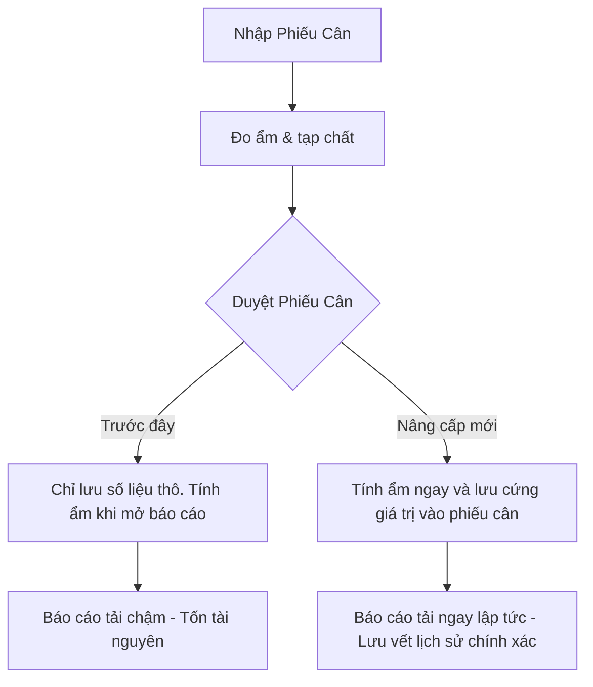

# Technical Translator — sk-tech-translator

## 🎯 Mục tiêu
Giúp kết nối khoảng cách giao tiếp giữa Đội ngũ Phát triển (Dev) và Quản lý Sản phẩm (PM/PO/Stakeholders). Kỹ năng này biến các cấu trúc code phức tạp và các thay đổi hạ tầng cơ sở dữ liệu khó hiểu thành các biểu đồ và ngôn ngữ nghiệp vụ rõ ràng, mô tả rõ **giá trị kinh doanh** và **mức độ ảnh hưởng (blast radius)** của thay đổi.

---

## ⚙️ Quy Trình Thực Thi Của Agent

### Bước 1: Phân tích thay đổi kỹ thuật
*   Xác định các thành phần kỹ thuật bị ảnh hưởng (ví dụ: Sửa bảng cơ sở dữ liệu, tối ưu hóa câu lệnh query N+1, chia nhỏ lớp dịch vụ).
*   Định vị mục tiêu: PM/PO muốn biết gì? (Ảnh hưởng đến tính năng nào? Hệ thống chạy nhanh hơn bao nhiêu? Rủi ro gián đoạn dịch vụ là gì?).

### Bước 2: Biên dịch sang ngôn ngữ nghiệp vụ
*   Tránh dùng các thuật ngữ thuần code như `Dependency Injection`, `Entity Framework Tracker`, `Reflection`, `Index Scan`.
*   Thay thế bằng các thuật ngữ nghiệp vụ tương ứng:
    - *Query N+1* -> *Hiện tượng nghẽn mạng khi load danh sách*.
    - *Database Index* -> *Mục lục giúp tìm kiếm phiếu cân nhanh hơn*.
    - *Refactoring* -> *Sắp xếp lại cấu trúc bên trong hệ thống để dễ nâng cấp*.

### Bước 3: Minh họa bằng Mermaid & Bảng So Sánh
*   **Bắt buộc vẽ sơ đồ Mermaid** trực quan hóa sự khác biệt (trước và sau khi đổi, hoặc luồng dữ liệu).
*   Sử dụng bảng so sánh tác động nghiệp vụ (Impact Matrix).

---

## 📖 Ví dụ thực tế: Nâng cấp cơ chế tính độ ẩm Biomass từ tính toán tức thời (on-the-fly) sang lưu vết lịch sử (history logging)

### Tài liệu giải thích cho PM:

#### 1. Tại sao cần thay đổi này? (Vấn đề kỹ thuật)
Trước đây, hệ thống tính toán tỷ lệ độ ẩm của lô hàng sinh khối (Biomass) một cách tức thời mỗi khi xuất báo cáo. Cách làm này khiến hệ thống phải tính toán lại hàng triệu dòng dữ liệu cân cũ, gây chậm tải trang và không lưu lại được lịch sử độ ẩm tại thời điểm cân nếu quy tắc tính toán thay đổi.

#### 2. Luồng hoạt động mới (Business Flow)
Hệ thống sẽ lưu trực tiếp tỷ lệ độ ẩm cuối cùng vào bảng dữ liệu của phiếu cân tại thời điểm duyệt phiếu.

#### 3. Bảng phân tích tác động nghiệp vụ (Impact Matrix)

| Khu vực ảnh hưởng | Hiện trạng cũ | Giải pháp mới | Tác động kinh doanh |
|-------------------|--------------|---------------|--------------------|
| **Tốc độ báo cáo** | Chậm (mất 10-15s cho 10,000 phiếu cân) | Nhanh tức thì (<0.5s) | Giảm thời gian chờ đợi của kế toán cảng. |
| **Tính chính xác dữ liệu** | Có thể bị thay đổi nếu công thức tính ẩm thay đổi sau này | Bảo đảm số liệu lịch sử bất biến | Phục vụ kiểm toán tài chính chính xác tuyệt đối. |
| **Rủi ro gián đoạn** | Không có | Cần chạy 1 script cập nhật dữ liệu cũ (migration) | Cần dừng hệ thống trạm cân khoảng 5 phút vào ban đêm để cập nhật. |
