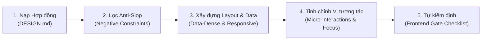

# UI Craftsmanship & Anti-Slop Discipline — sk-ui-craft

## 🎯 Mục tiêu

Đảm bảo mọi dòng mã nguồn giao diện do AI sinh ra đều đạt chuẩn thiết kế phần mềm thương mại cao cấp (Studio-Grade), xóa bỏ hoàn toàn cảm giác "hàng AI sinh ra giá rẻ" (AI Slop). Agent đóng vai trò như một **Senior Design Engineer**, kết hợp chặt chẽ giữa tính thẩm mỹ, hiệu năng chuyển động mượt mà và kỷ luật kỹ thuật tiếp cận (Accessibility).

---

## 🚀 Quy Trình Thực Thi 5 Bước



### Bước 1: Nạp Hợp đồng Thiết kế (`DESIGN.md`)
Trước khi viết mã UI:
1. Tìm file `DESIGN.md` tại root dự án hoặc `.agents/context/DESIGN.md`.
2. Nếu dự án chưa có `DESIGN.md`, tham vấn Developer hoặc khởi tạo nhanh từ `templates/DESIGN.md.template`.
3. Trích xuất các token: Bảng màu (Primary, Surface, Accent, Status), Typography scale, và Radius để dùng nhất quán trong toàn bộ task.

### Bước 2: Kiểm soát & Chặn đứng "AI UI Slop"
Tuyệt đối **KHÔNG** vi phạm các lỗi giao diện rập khuôn phổ biến sau:
- ❌ **Cấm dải màu tím-xanh mặc định:** Không dùng `from-purple-600 to-blue-600` hoặc các dải gradient neon ngẫu hứng khi không được yêu cầu trong `DESIGN.md`.
- ❌ **Cấm Icon dạng Emoji:** Tuyệt đối không dùng emoji thô (`🚀`, `✨`, `🔥`, `💡`, `✅`) làm icon trên nút bấm, tiêu đề hoặc badge. Sử dụng icon SVG stroke mảnh (1.5px stroke width) như Lucide, Heroicons, Radix Icons.
- ❌ **Cấm Logo chữ lồng hộp đồ chơi (Toy-box logo):** Không tạo icon logo bằng 2 chữ cái viết hoa nhét vào hình vuông bo góc tô màu chuyển sắc.
- ❌ **Cấm Nút dạng "Viên thuốc dài ngoằng" (Elongated Pill CTA):** Tránh dùng `rounded-full px-12 py-4` trên các form thông thường; ưu tiên bo góc cân xứng (`rounded-md` hoặc `rounded-lg`).
- ❌ **Cấm Typography AI Slop:** Không dùng các font như `Space Grotesk`, `Syne`, `Outfit` cho giao diện ứng dụng nghiệp vụ; ưu tiên `Inter`, `Geist`, `Roboto`, hoặc hệ font Native System.

### Bước 3: Chuẩn hóa Giao diện Dữ liệu Nghiệp vụ (Enterprise Data-Dense)
- **Căn chỉnh số liệu (Numeric Alignment):** Mọi trường số liệu tài chính, số lượng, mã đơn, và ngày tháng phải dùng class số đơn cách (`tabular-nums` hoặc `font-mono`) và căn lề phải (right-aligned).
- **Phân cấp trạng thái rõ ràng:** Thẻ trạng thái dữ liệu (Status Tag) phải theo chuẩn:
  - `Draft`: Màu trung tính (Slate/Gray).
  - `Pending`: Màu hổ phách/vàng ấm (Amber).
  - `Active / Approved`: Màu xanh ngọc (Emerald).
  - `Error / Rejected`: Màu đỏ thẩm mỹ (Red/Rose).
- **Trạng thái bảng và danh sách:** Luôn chuẩn bị trước:
  - Skeleton loading (hoặc Spinner tinh tế) khi đang nạp dữ liệu.
  - Empty state có hướng dẫn hành động (Actionable) khi danh sách rỗng.
  - Xử lý tràn chữ bằng `truncate` kèm `title` hiển thị full text khi hover.

### Bước 4: Vi tương tác & Chuyển động Mượt mà (Emil Kowalski Principles)
1. **Phản hồi xúc giác (Tactile Press):** Nút bấm khi nhấn chuột phải có cảm giác lún thật:
   ```css
   /* Tailwind class */
   transition-all duration-150 active:scale-[0.98]
   ```
2. **Không bao giờ phóng to từ hư không (`scale(0)`):**
   - Hộp thoại (Modal, Dialog) hoặc Menu xuất hiện: Bắt đầu từ `scale(0.95)` và mờ nhẹ (`opacity-0`) đến `scale(1)` và `opacity-100`.
   - Sử dụng đường cong tự nhiên: `ease-out` cho trạng thái vào (enter) và `ease-in` cho trạng thái thoát (exit).
3. **Bàn phím & Focus Ring:**
   - Tuyệt đối không xóa outline mà không thay thế (`outline: none` là cấm kỵ).
   - Sử dụng vòng sáng rõ rệt: `focus-visible:ring-2 focus-visible:ring-offset-2 focus-visible:ring-accent`.

### Bước 5: Kỷ luật Responsive & Touch Target (Mobile Hygiene)
- **Zero Horizontal Overflow:** Kiểm tra giao diện co giãn liên tục từ **320px** đến **1920px**. Bất kỳ phần tử nào gây thanh cuộn ngang ngoài ý muốn đều bị coi là lỗi nghiêm trọng.
- **Kích thước chạm tối thiểu:** Nút bấm, checkbox, radio, tab switch trên màn hình cảm ứng phải đạt diện tích bấm tối thiểu **$44 \times 44$px** (có thể dùng padding để tăng diện tích chạm thực tế).

---

## 🛡️ Frontend Quality Gate Checklist (Tự kiểm trước khi báo hoàn tất)

Trước khi cập nhật trạng thái `READY` trong Execution Contract, Agent phải tự xác thực:

- [ ] Đã kiểm tra tính nhất quán với màu sắc và typography trong `DESIGN.md`.
- [ ] Không chứa bất kỳ mã cấm Anti-Slop nào (`BAN-01` đến `BAN-06`).
- [ ] Mọi element tương tác đều có đủ 4 trạng thái: Default, `:hover`, `:focus-visible`, `:active` / `:disabled`.
- [ ] Đã kiểm tra hiển thị không tràn ngang ở kích thước màn hình 320px.
- [ ] Đã hỗ trợ `prefers-reduced-motion` cho các hiệu ứng chuyển động quan trọng.
- [ ] Icon sử dụng định dạng SVG chuẩn, không dùng raw emoji trong các thành phần điều khiển.
