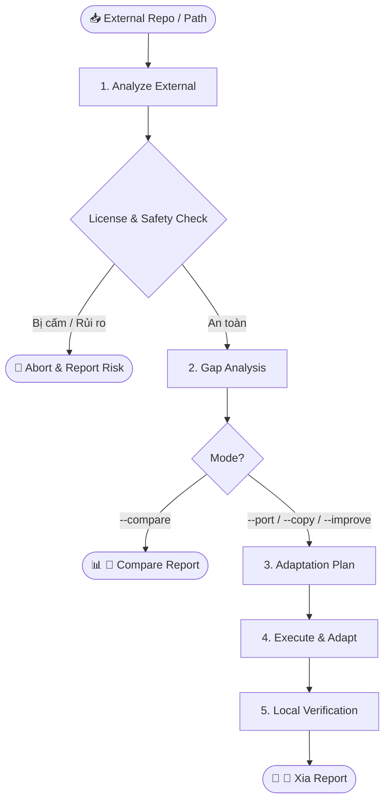

# External Intelligence Assimilation — adk-xia

> Tái sinh và chuẩn hóa từ quy trình `workflows/wf-xia.md` truyền thống sang chuẩn **Agent Skills Specification (v0.9.0)**.
> Triết lý: *"Đứng trên vai người khổng lồ một cách kỷ luật."* — Học hỏi, tiếp thu tinh hoa từ kho mã nguồn mở và external reference repositories mà không làm ô nhiễm kiến trúc hay vi phạm bản quyền dự án nội bộ.

---

## 🎯 Mục tiêu & Khi nào dùng

- **Mục tiêu:** Phân tích mã nguồn của external repo/thư viện mẫu, bóc tách pattern, thuật toán hoặc luồng xử lý, sau đó port vào dự án hiện tại theo đúng phong cách thiết kế và quy ước của `AGENTS.md`.
- **Khi nào dùng:**
  - Khi tìm thấy một library, component, hoặc repo GitHub có tính năng tương tự muốn đưa vào dự án.
  - Khi muốn so sánh cách triển khai giữa external repo và codebase hiện tại để tìm điểm tối ưu.
  - Khi cần sao chép một thuật toán phức tạp nhưng muốn viết lại bằng tech stack nội bộ.
- **Không dùng khi:**
  - Tra cứu nhanh docs/API của một thư viện thông thường (hãy dùng `adk-docs-seeker`).
  - Nghiên cứu khảo sát xu hướng chung đa nguồn (hãy dùng `adk-deep-research`).

---

## 🎛️ 4 Modes Hoạt Động

| Mode | Mục đích | Hành vi mã nguồn |
|---|---|---|
| `--compare` | Phân tích & đối chiếu | **Read-Only:** Chỉ so sánh kiến trúc, luồng xử lý và dependencies. Tuyệt đối KHÔNG sửa code cục bộ. |
| `--port` *(Mặc định)* | Tiếp thu & viết lại | Hiểu sâu concept và thuật toán, sau đó **code lại từ đầu** bằng ngôn ngữ, style và conventions của local project. |
| `--copy` | Sao chép có tinh chỉnh | Áp dụng khi cùng tech stack: copy logic gốc nhưng bắt buộc đổi namespace, imports, naming và xử lý lỗi. |
| `--improve` | Kế thừa & nâng cấp | Sao chép logic gốc kết hợp tái cấu trúc: nâng cấp SOLID, bổ sung error boundary, typesafety và unit tests đầy đủ. |

---

## 🔄 Quy Trình 5 Bước Chuyển Giao (The 5-Step Assimilation Loop)



### Bước 1: Analyze External (Khảo sát nguồn ngoài)
- Khảo sát cấu trúc repo nguồn, định vị các files/modules chứa tính năng mục tiêu.
- Trích xuất luồng dữ liệu (Data Flow), State Management, và các side effects chính.

### Bước 2: Gap Analysis & Safety Gate (Kiểm định rào cản)
- **License Check:** Kiểm tra giấy phép mã nguồn (MIT, Apache 2.0, BSD vs GPL/AGPL). Cảnh báo nguy cơ lây nhiễm bản quyền nếu repo nguồn có giấy phép copyleft nghiêm ngặt.
- **Dependency Audit:** Liệt kê các thư viện ngoài mà mã nguồn đó phụ thuộc. Đối chiếu với `AGENTS.md` để tìm thư viện thay thế sẵn có trong dự án, tránh kéo thêm dependencies lạ.

### Bước 3: Adaptation Plan (Lập kế hoạch bản địa hóa)
- Xác định vị trí đích trong cấu trúc thư mục của local project (`src/...`).
- Lập bảng ánh xạ kiểu dữ liệu (Type Mapping), hàm xử lý lỗi và logging chuẩn của dự án.

### Bước 4: Execute & Adapt (Triển khai thích ứng)
- Triển khai mã nguồn theo mode đã chỉ định (`--port`, `--copy`, hoặc `--improve`).
- Tuân thủ nghiêm ngặt **Ponytail Rule**: chỉ lấy phần logic thực sự cần thiết, loại bỏ abstractions thừa thãi.
- Cấm copy verbatim khi dùng chế độ `--port`.

### Bước 5: Local Verification (Kiểm định cục bộ)
- Chạy toàn bộ build, typecheck, linter và tests của local project.
- Đảm bảo tính năng mới tích hợp mượt mà, không gây regression lỗi cho các module cũ.

---

## 🛡️ Guardrails & Nguyên Tắc Bất Di Bất Dịch

1. ❌ **Cấm Copy-Paste Mù Quáng:** Không bê nguyên văn phong code của external repo nếu nó xung đột với `rules/global.md` và `AGENTS.md`.
2. ❌ **Cấm Tùy Tiện Cài Thư Viện Mới:** Luôn ưu tiên dùng standard library hoặc các package đã có sẵn trong `package.json` / `requirements.txt`.
3. ❌ **Zero License Contamination:** Nếu phát hiện mã nguồn nguồn có giấy phép GPL/AGPL mà dự án nội bộ là proprietary/closed-source, Agent BẮT BUỘC dừng lại và cảnh báo nguy cơ pháp lý.

---

## 📋 Hợp Đồng Đầu Ra Bắt Buộc

### Khi chạy Mode `--compare`:
```markdown
## 🔄 Compare Report: <Target Feature>
- **external_source:** `<URL hoặc đường dẫn repo mẫu>`
- **local_baseline:** `<Đường dẫn module hiện tại trong dự án>`

| Tiêu chí | External Implementation | Local Implementation | Đánh giá & Khuyến nghị |
|---|---|---|---|
| Kiến trúc / Pattern | Event-Driven / PubSub | Service Layer tuần tự | Nên giữ Service Layer để tránh phức tạp |
| Dependencies | Yêu cầu 3 thư viện phụ | Đã có helper nội bộ | Dùng helper nội bộ |
| Xử lý lỗi & Edge cases | Có retry + circuit breaker | Chỉ có try/catch cơ bản | Nên học tập cơ chế retry |
```

### Khi chạy Mode `--port`, `--copy`, hoặc `--improve`:
```markdown
## 🔀 Xia Report: <Target Feature>
- **mode:** `--port` | `--copy` | `--improve`
- **source_origin:** `<URL / Đường dẫn repo ngoài>`
- **license_audit:** `MIT (Safe for adoption)`

### 📁 Mã nguồn được bản địa hóa
| File tạo mới / chỉnh sửa (`path:line`) | Loại thay đổi | Mô tả thích ứng kỹ thuật |
|---|---|---|
| `src/utils/crypto.ts:1-45` | Add | Port thuật toán hashing, thay đổi crypto library theo local stack |

### 🧪 Executable Verification
- **verified_cmd:** `<Lệnh test/build local đã chạy>` -> `PASS (<chi tiết>)`
- **open_risks:** NONE
```
